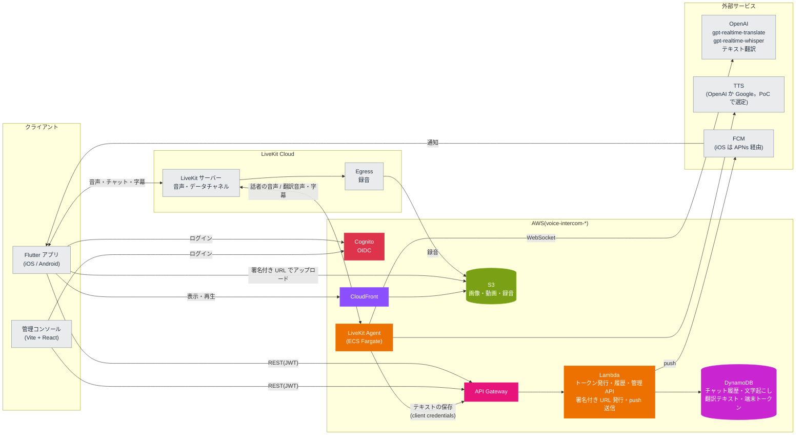

# voice-intercom

翻訳つきのボイスインカムアプリ。設計は [docs/設計メモ.md](docs/設計メモ.md) を参照。

## アーキテクチャ

音声・チャット・字幕は LiveKit で配信し、Agent が OpenAI で翻訳と文字起こしをする。履歴・メディア・トークン発行は AWS サーバーレスで持つ。



## 構成

| パス | 内容 | 開発する場所 |
| --- | --- | --- |
| `apps/mobile` | Flutter アプリ(iOS / Android) | ホスト |
| `apps/admin` | 管理コンソール(Vite + React) | devContainer |
| `services/agent` | LiveKit Agent(Python) | devContainer |
| `services/api` | API Gateway + Lambda(Python) | devContainer |
| `proto/` | データチャネルで流すメッセージの定義(Protobuf) | devContainer |
| `packages/schema/{python,ts,dart}` | `proto/` から生成した型。生成物もコミットする | 生成は devContainer |
| `packages/api-client/{ts,dart}` | REST API のクライアント。`services/api` の Pydantic のモデルから出した `openapi.json` をもとに生成する。生成物もコミットする | 生成は devContainer |
| `infra/` | Terraform(`envs/dev`、`envs/prod`。同じ AWS アカウントで名前を分ける) | devContainer |

## セットアップ

### ホスト(Apple Silicon の Mac)

1. Docker Desktop と [mise](https://mise.jdx.dev) を入れる(`brew install mise`)。
2. `cp .env.example .env` を実行し、`DEV_HOST` と `OIDC_ISSUER` をホストの LAN の IP に書き換える。
3. `mise install` を実行する(ローカルの LiveKit サーバー用)。Flutter を使うときは `apps/mobile` でも `mise install` を実行する。
4. Flutter の iOS ビルドには Xcode が必要。初回は `sudo xcodebuild -license` で同意しておく。

### devContainer

VS Code で「Reopen in Container」を選ぶ。初回に `.devcontainer/post-create.sh` が、ツールと依存関係(`uv sync`、`pnpm install`)を入れる。

## よく使うコマンド

| コマンド | 内容 | 実行する場所 |
| --- | --- | --- |
| `mise run gen` | proto から型を、REST API から OpenAPI とクライアントを生成する(`gen:proto`、`gen:api`)。Dart のクライアントの生成に使う Java は、初回にこのタスクが入れる | devContainer |
| `mise run lint` | buf lint、ruff、pyright、tsc | devContainer |
| `mise run fmt` | 整形 | devContainer |
| `mise run test` | pytest | devContainer |
| `mise run api` | REST API をローカルで起動する(`http://localhost:3000`。ローカルの DynamoDB・S3・模擬 OIDC につなぐ) | devContainer |
| `mise run admin` | 管理コンソールの開発サーバーを起動する(`http://localhost:5173`) | devContainer |
| `mise run livekit` | ローカルの LiveKit サーバーを起動する(`--dev`、LAN に公開) | ホスト |
| `mise run build:api` | Lambda に載せるディレクトリ(`.build/api`)を作る | devContainer |
| `mise run build:agent` | Agent のイメージを linux/arm64 でビルドする(`voice-intercom-agent:local`) | devContainer |
| `mise run push:agent <env>` | Agent のイメージをビルドして ECR に push し、apply に渡すタグを表示する | devContainer |
| `mise run plan:dev` | `build:api` の後に、dev 環境の `terraform plan` を実行する | devContainer |
| `mise run local:init` | ローカルの DynamoDB と S3 に、テーブルとバケットを作る | devContainer |

## CI(GitHub Actions)

PR と main への push で動く。ツールは mise で `mise.toml` と同じ版を入れ、ジョブの中身は上の `mise run` のタスクと揃えてある。Flutter はまだ対象にしていない。

| ワークフロー | 動く条件 | 内容 |
| --- | --- | --- |
| `ci.yml` | 毎回 | `mise run lint`、`mise run test`、`buf breaking`(PR はベースブランチ、main への push は push 前と比べる) |
| `gen.yml` | proto、`services/api`、生成物、lock ファイル、`mise.toml` などが変わったとき | `mise run gen` の後に差分がないか(生成物が古ければ落ちる) |
| `terraform.yml` | `infra/` か `mise.toml` が変わったとき | `terraform fmt -check`、`envs/dev`・`envs/prod` の `init -backend=false` と `validate`(AWS には接続しない) |

- action はタグではなくコミット SHA で固定し、横にタグを書く。共通の準備(mise、uv、pnpm とそのキャッシュ)は `.github/actions/setup` にまとめてある。
- `terraform init` は lock ファイルを書き換えない(`-lockfile=readonly`)。プロバイダーを上げたら、`terraform providers lock -platform=linux_amd64 -platform=linux_arm64 -platform=darwin_arm64` で CI の分のハッシュも入れる。
- `gen.yml` と `terraform.yml` はパスで絞っているので、必須のチェックにすると、関係のない PR が待ち続ける。必須にするのは `ci.yml` のジョブだけにする。

## AWS(Terraform)

`infra/modules` に Cognito、DynamoDB、S3 + CloudFront(`media`)、録音の S3(`recordings`)、API Gateway + Lambda(`api`)、LiveKit Agent の ECS Fargate(`agent`)のモジュールがあり、`infra/envs/<env>` から呼ぶ。

1. `.env` に `AWS_PROFILE` と `TF_STATE_BUCKET` を書き、`aws sso login` する。
2. 初回だけ `terraform -chdir=infra/envs/dev init -backend-config="bucket=$TF_STATE_BUCKET"` を実行する。state 用のバケットがまだなければ、先に `scripts/bootstrap-tfstate.sh` で作る(dev と prod で共用し、キーで分ける)。
3. `mise run plan:dev` で差分を確かめてから、`terraform -chdir=infra/envs/dev apply` する。
4. 初回の apply の後に、LiveKit の API シークレットを SSM に入れる(Terraform には値を持たせない)。

   ```sh
   aws ssm put-parameter --overwrite --type SecureString \
     --name /voice-intercom-dev/livekit/api-secret --value <secret>
   ```

5. push 通知(FCM)のサービスアカウントの JSON を SSM に入れる。Firebase コンソールの「プロジェクトの設定 > サービス アカウント」で秘密鍵(JSON)を作り、ファイルのまま入れる(`file://` で読ませると改行も崩れない)。入れたらファイルは消す。

   ```sh
   aws ssm put-parameter --overwrite --type SecureString \
     --name /voice-intercom-dev/fcm/service-account --value file://service-account.json
   ```

   API の Lambda は実行環境が立ち上がるときに1回だけ読む。値を入れ替えたら、Lambda のコードか設定を更新して実行環境を入れ替える。値が初期値(`CHANGE_ME`)のままだと、通知を送るところでエラーになる。

LiveKit の URL と API キーは `TF_VAR_livekit_client_url`、`TF_VAR_livekit_api_key` で渡す。

### LiveKit Agent(ECS Fargate)

Agent は `services/agent/Dockerfile` のイメージ(linux/arm64)を、ECS Fargate(ARM64)で動かす。モジュールは `infra/modules/agent`。

1. 初回の apply では ECR などができるだけで、タスクは起動しない(`agent_image_tag` が空のうちは台数を 0 にする)。
2. OpenAI の API キーを SSM に入れる(LiveKit の API シークレットと同じく、Terraform には値を持たせない)。prod では LiveKit の API シークレットも同じように入れる。

   ```sh
   aws ssm put-parameter --overwrite --type SecureString \
     --name /voice-intercom-dev/openai/api-key --value <key>
   ```

   dev では、Agent が履歴を保存する(確定した字幕を API に PUT する)ときに使う、Cognito の Agent のクライアントシークレットも SSM に入れる。値は Cognito が作るので、Terraform の出力(sensitive)から写す。Terraform のタスク定義には SSM のパラメーターの ARN だけを渡す(OpenAI のキーと同じ)。シークレットの値は Cognito のクライアントのリソースとして state に入っているが、SSM のパラメーターの値としては持たせない。prod にはまだ Cognito と API が無いので、履歴は保存しない(`history = null`)。

   ```sh
   aws ssm put-parameter --overwrite --type SecureString \
     --name /voice-intercom-dev/cognito/agent-client-secret \
     --value "$(terraform -chdir=infra/envs/dev output -raw agent_client_secret)"
   ```

   Cognito のクライアントを作り直したとき(シークレットが変わる)も、同じコマンドで入れ直し、下の `update-service` でタスクを入れ替える。

3. コミットしてから、イメージを ECR に push する。最後に apply に渡すタグ(コミットのハッシュ)が表示される。

   ```sh
   mise run push:agent dev
   ```

4. タグを渡して apply する。タスクが起動し、LiveKit に登録する。ログは CloudWatch Logs の `/ecs/voice-intercom-dev-agent`。

   ```sh
   TF_VAR_agent_image_tag=<タグ> terraform -chdir=infra/envs/dev apply
   ```

SSM の値を変えたときは、新しいタスクでないと読み直さない。`aws ecs update-service --force-new-deployment --cluster voice-intercom-dev-agent --service voice-intercom-dev-agent` で入れ替える。dev を使わないときは `TF_VAR_agent_max_count=0` で apply すると、台数が 0 になり Fargate の料金がかからない。

方針(理由の詳細は `infra/modules/agent` のコメント):

- **ネットワーク**: 環境ごとに VPC を作り、パブリックサブネットに public IP つきで置く。受信はセキュリティグループで全部閉じ、送信だけを許す。NAT Gateway(1つで月 45 USD ほど)と VPC エンドポイントは使わない。ヘルスチェックの 8081 はコンテナの中から叩くので開けない。
- **停止**: `stopTimeout` は Fargate の上限の 120 秒。Agent は `SIGTERM` で新しいジョブを断り、実行中のジョブを待つが、120 秒を超えるルームは切れ、約15秒で別のタスクに再ディスパッチされる。そのため、ジョブを持つタスクには下のタスク保護を付け、スケールインとデプロイでは止めさせない。
- **デプロイ**: 新しいタスクを先に起動してから古いタスクを止める(minimum healthy 100% / maximum 200%)。起動しなければ前のタスク定義に戻す(サーキットブレーカー)。AZ の偏りを直すためのタスクの入れ替え(AZ リバランシング)は切ってある。タスク保護との関係は次のとおり。
  - ジョブを持つ古いタスクは、保護が外れるまで止められない。新しいタスクは起動し(maximum 200% なので、保護中の古いタスクと並べられる)、デプロイは古いタスクが止まるまで `IN_PROGRESS` のまま続く。ECS は、保護中のタスクがデプロイを止めているとサービスのイベントで知らせる。
  - サーキットブレーカーは、新しいタスクが `RUNNING` にならない回数とヘルスチェックの失敗の回数だけを数え、デプロイにかかる時間では打ち切らない。古いタスクが保護で残っていても失敗にもロールバックにもならない。`terraform apply` はデプロイの完了を待たない(`wait_for_steady_state` を使っていない)。
  - 保護中の古いタスクも LiveKit には登録したままなので、新しいルームを受けることがある。ルームが絶えないと保護が延長され続けるので、Agent は保護を続ける長さに上限(`TASK_PROTECTION_MAX_HOURS`、既定 12 時間)を置き、過ぎたら延長をやめる。期限(既定 60 分)が切れると古いタスクは止められ、残っていたルームは 120 秒で切れて新しいタスクに再ディスパッチされる。つまり、デプロイはルームが無くなりしだい終わり、長くても約 13 時間で終わる。
  - 前のデプロイが終わる前に次のデプロイを始めると、ロールバック先(`COMPLETED` のデプロイ)が無く、サーキットブレーカーが戻せないことがある。`aws ecs describe-services` の `deployments[].rolloutState` が `COMPLETED` になってから次を出す。急ぐなら、ルームの少ない時間に出す。
- **台数**: CPU 使用率(サービスのタスクの平均)のターゲット追跡でオートスケールする。目標は 50%(`cpu_target_percent`)、スケールアウトの後は 120 秒、スケールインの後は 900 秒待つ。dev は 1 vCPU・2GB を 1〜2 つ(`agent_min_count`・`agent_max_count`)、prod は 4 vCPU・8GB を 1〜4 つ。prod を冗長にするなら `agent_min_count` を 2 に。最小を 0 にすると、CPU の指標が出ないので 0 台から増えない(止めたいときだけ `agent_max_count` を 0 にする)。台数はオートスケールが変えるので、Terraform はサービスの `desired_count` を作るときにしか使わない(`ignore_changes`)。`agent_image_tag` が空の間は最大を 0 にし、0 台にする。Fargate Spot は、2分前の通知で止められるので使わない。
  - **CPU の目標と LiveKit の負荷の閾値**: LiveKit のワーカーは、自分の CPU 使用率(cgroup で測る、2.5 秒の移動平均)が `load_threshold`(本番の既定 0.7)以上になると「満杯」になり、新しいジョブを断る(LiveKit はほかのワーカーに回す)。ECS の指標は 1 分ごとの全タスクの平均なので、目標を閾値と同じ 70% にすると、平均が届く前に一部のタスクが断り始め、増えるのも遅れる。タスクの起動と LiveKit への登録にも 1〜2 分かかるので、目標は閾値より低い 50% にして早めに増やす(設計メモの「0.5 付近で早めにスケールアウト」)。目標を上げるなら、閾値(70%)より下に収める(変数の検証で 70 未満に制限している)。
- **録音**: Agent は話者ごと・発話ごとの録音(Ogg/Opus)を、録音用のバケット `voice-intercom-<env>-recordings-<アカウント ID>`(`infra/modules/recordings`)に置く。キーは `rooms/<room_id>/<YYYY>/<MM>/<DD>/<utterance_id>-<speaker_id>.ogg`(詳しくは `services/agent/README.md` の「録音」)。LiveKit の Egress は使わない(固定費を抑えるため。設計メモの「録音の方式」)。
  - 画像・動画のバケット(media)には置かない。media は CloudFront の既定の振る舞いがバケット全体を署名なしで配信するので、キーが分かれば誰でも聞けてしまう。録音のバケットは CloudFront につながず、パブリックアクセスをすべてブロックし、SSE-S3 で暗号化し、HTTPS 以外を拒む。
  - タスクロールには `rooms/*` への `s3:PutObject` だけを許す(読み取り・一覧・削除はできない)。タスク定義に `RECORDING_BUCKET` と `AWS_DEFAULT_REGION` を渡す。聞くときは、管理者の権限で `aws s3 cp` などで取り出す。
  - 古い録音はライフサイクルで消す。日数は `recording_retention_days`(dev 30日、prod 365日)。途中で止まったマルチパートアップロードは1日で消す。
  - Agent が落ちている間、デプロイやスケールインで 120 秒を超えたルームが切られた後、再ディスパッチまでの約15秒は録れない。この抜けは許容する。
  - S3 へは public IP から出る(VPC エンドポイントは作っていない。S3 のゲートウェイ型エンドポイントは無料なので、必要になったら足せる)。
- **タスク保護**: Agent はジョブ(ルーム)を持つ間だけ、ECS のタスクのスケールイン保護を付ける(`services/agent/src/voice_intercom_agent/task_protection.py`)。コンテナの中の ECS エージェントのエンドポイント(`$ECS_AGENT_URI/task-protection/v1/state`)を使い、ECS エージェントはタスクロールの権限(`ecs:UpdateTaskProtection`・`ecs:GetTaskProtection`。モジュールで付ける)で ECS の API を呼ぶ。
  - ジョブが 0 から 1 以上になったら付け、0 に戻ったら外す。期限は 60 分(`TASK_PROTECTION_EXPIRES_MIN`、最大 2880 分)にして、ジョブがある間は 20 分ごと(`TASK_PROTECTION_RENEW_MIN`)に延長する。Agent が落ちても、保護は最長 60 分で切れる。
  - スケールインは保護の付いていないタスクからしか止めない。ルームが少ないうちは各タスクに散らばるので、CPU が下がっても台数が減らないことがある。
  - 保護の付け外しに失敗しても(権限、`DEPLOYMENT_BLOCKED` など)、ジョブは止めずにログに残し、30 秒後にやり直す。`ECS_AGENT_URI` の無いローカルでは何もしない。

## REST API

`services/api`(API Gateway + Lambda)。`/health` 以外はアクセストークン(Bearer)が要る。管理者は `cognito:groups` に `admin` がある人。型の正は Pydantic のモデルで、仕様は [packages/api-client/openapi.json](packages/api-client/openapi.json)。

| エンドポイント | 内容 | 使える人 |
| --- | --- | --- |
| `GET /health` | 死活監視 | だれでも |
| `GET /rooms` | ルームの一覧(`{items}`) | 管理者はすべて、それ以外は自分がメンバーのルーム |
| `POST /rooms` | ルームを作る。同じ `room_id` があれば 409 | 管理者 |
| `GET /rooms/{room_id}` | ルームを取る | 管理者、メンバー |
| `PATCH /rooms/{room_id}` | 名前とメンバー(`member_ids`、Cognito の sub)を変える | 管理者 |
| `DELETE /rooms/{room_id}` | ルームを消す(204) | 管理者 |
| `GET /users/me` | 自分のプロフィール(表示名、言語)。未登録なら 404 | 本人 |
| `PUT /users/me` | プロフィールを登録・更新する | 本人 |
| `PUT /users/me/devices` | push 通知の端末トークンを登録する(`{token, platform: "ios" \| "android"}`、204)。アプリの起動時とトークンの更新時に呼ぶ | 本人 |
| `DELETE /users/me/devices` | 端末トークンを外す(本文に `{token}`、204)。ログアウトのときに呼ぶ。登録されていなくても 204 | 本人 |
| `GET /users` | プロフィールを登録したユーザーの一覧(`{items}`) | 管理者 |
| `POST /livekit/token` | LiveKit の参加用トークン。プロフィールの表示名を name に、言語を参加者の属性 `language` に入れる。ルームがなければ 404、プロフィールが未登録なら 409 | 管理者、メンバー |
| `GET /rooms/{room_id}/timeline` | ルームの履歴(`{items, next_before}`)を新しい順に。`limit`(1〜100、既定 50)と `before`(前の応答の `next_before`)でページングする | 管理者、メンバー |
| `PUT /rooms/{room_id}/timeline/{source_id}` | 発話(`utterance`、字幕の区切りごと)かテキスト入力(`text`)を履歴に保存する。`event_id` は `<occurred_at>#<source_id>` で、同じなら置き換える(再送しても1件) | Agent |
| `POST /rooms/{room_id}/media/uploads` | 画像・動画を S3 に PUT する署名付き URL(本体と、`has_thumbnail` ならサムネイル)。期限は1時間 | 管理者、メンバー |
| `POST /rooms/{room_id}/media/{media_id}/complete` | アップロードした画像・動画を履歴(`media`)に保存する。本体かサムネイルがまだ置かれていなければ 409。2回目からは同じ履歴を返す | アップロードした本人 |

言語は gpt-realtime-translate が出力できる13言語のコード(`ja`、`en` など)。Agent の翻訳先はこの言語で決まるので、プロフィールがないとトークンを発行しない。

Agent は client credentials のトークン(スコープ `voice-intercom/agent`)で呼ぶ。Agent のトークンは利用者向けのエンドポイントでは 403、`PUT .../timeline/...` は利用者のトークンでは 403 になる。

画像・動画のアップロード:

1. `POST .../media/uploads` に `content_type`(`image/jpeg`、`image/png`、`image/webp`、`image/heic`、`video/mp4`)と `size_bytes` を送り、`upload_url` をもらう。
2. `upload_url` に本体を PUT する。**Content-Type ヘッダーを `content_type` と同じにする**(署名に含めてあり、違うと S3 も SeaweedFS も 403)。サムネイルは `thumbnail_upload_url` に `image/jpeg` で PUT する。
3. `POST .../media/{media_id}/complete` を呼ぶ(`text` で文を添えられる)。履歴の `media.url`(CloudFront)で表示・再生する。

- 本体の上限は 100MB で、単一の PUT だけにしている。設計メモの「100MB 以上はマルチパート」は後回し(未完了のマルチパートを消すライフサイクルルールは、`infra/modules/media` に既にある)。署名付き URL では大きさを縛れないので、complete で置かれた大きさを確かめ、上限を超えていれば 409 にする。
- S3 のキーは `rooms/<room_id>/<media_id>/original` と `.../thumbnail`。
- complete を呼べる人は、uploads のときに timeline テーブルへ書く仮の行(`room_id` が `media-upload#<room_id>`。履歴には出ない。1日で TTL が消す)で確かめる。理由は `services/api` の `media.py` のコメント。
- CloudFront の URL は署名なしで読める。`media_id` は推測できない乱数(UUID4)にしている。

### push 通知

端末トークンは users テーブルの項目(`devices`)に持たせる。詳しくは `services/api/src/voice_intercom_api/device_store.py` と `devices.py`。

- 解除はトークンを本文で渡す。FCM のトークンは長く `:` などを含み、知っていればその端末に通知を送れるので、URL(パス)には出さない。
- 1人 10 台まで。超えたら、最後に登録した時刻がいちばん古い端末を外す(再インストールで残った古いトークンから外れる)。
- 同じトークンを別の人が登録したら、前の人から外す(ログアウトせずに別の人がログインした端末に、前の人の通知が届かないように)。
- プロフィールの登録より先に端末を登録してもよい。プロフィールが未登録のうちは `GET /users/me` は 404 のまま。

送るのは `voice_intercom_api.notify` の `send_to_users`。どこから送るか(チャット、発話)は、履歴の API ができてからつなぐ。

```python
from voice_intercom_api import notify

# だれに送るか(送り主を除く、など)は呼び出し側で決める
recipients = [uid for uid in room.member_ids if uid != sender_id]
result = notify.send_to_users(
    recipients,
    title=room.name,
    body=f"{sender_name}: {text}",
    data={"type": "chat", "room_id": room.room_id},  # 値は文字列だけ
)
```

- Android は高優先度、iOS は通常の alert 通知で送る。FCM HTTP v1 は1トークンに1リクエストなので、並べて送る(同時に 8 本)。
- FCM が `UNREGISTERED` か、トークンが原因の `INVALID_ARGUMENT` を返したトークンは users から消す。それ以外の失敗(5xx、429、通信の失敗)はやり直さず、`SendResult` の `failed` に数えてログに出す。
- サービスアカウントの JSON が読めない(SSM の値が `CHANGE_ME` のままなど)と例外になる。チャットの保存などを通知の失敗で落とさないよう、呼び出し側で例外を捕まえてログに残す。
- 送る時間は API の Lambda の timeout(15秒)に含まれる。1回の HTTP は5秒で切る。人数が増えて応答が遅くなったら、SQS などで別の Lambda に分ける。
- ローカルでは、環境変数 `FCM_SERVICE_ACCOUNT` に JSON そのものを入れると送れる。`FCM_SERVICE_ACCOUNT` も `FCM_SERVICE_ACCOUNT_PARAMETER` もなければ、送らずにログだけ出す。

## ローカルの認証(模擬 OIDC サーバー)

本番は Cognito を標準の OIDC(認可コード + PKCE)で使う。ローカルでは、devContainer と一緒に起動する [mock-oauth2-server](https://github.com/navikt/mock-oauth2-server) に差し替える。

- issuer: `http://${DEV_HOST}:8090/default`(探索用の URL は `/.well-known/openid-configuration`)
- ログイン画面では任意のユーザー名と claims を入力できる。Cognito に寄せた claims の例:

  ```json
  { "cognito:groups": ["admin"], "token_use": "access", "client_id": "mobile" }
  ```

- client credentials(Agent から API を呼ぶとき)では、Cognito のアクセストークンと同じ形(`client_id`、`token_use`、`scope`)の claims を返す。設定は [.devcontainer/mock-oidc.json](.devcontainer/mock-oidc.json)。
- トークンの `iss` はリクエストの Host から決まる。そのため、クライアントは必ず `DEV_HOST` で接続する。コンテナ内から鍵(JWKS)を取るときは、`http://oidc:8090/default/jwks` を使う。

## 管理コンソール

`mise run admin` で起動し、ホストのブラウザで `http://localhost:5173` を開く(Cognito のリダイレクト先に合わせて、`localhost` で開く)。

- ログインは標準の OIDC(認可コード + PKCE)。ローカルでは模擬 OIDC のログイン画面が出るので、claims に次を入れる。`admin` グループがないと、ログインできても画面は見られない。

  ```json
  { "cognito:groups": ["admin"], "token_use": "access", "client_id": "admin", "email": "admin@example.com" }
  ```

- 画面:

  | パス | 内容 |
  | --- | --- |
  | `/rooms` | ルームの一覧。`/rooms/new` で作成、`/rooms/:roomId` で名前とメンバーの編集、削除 |
  | `/rooms/:roomId/timeline` | ルームの履歴(新しい順。「もっと見る」で古いものを読む)。区切られた発話はまとめて出し、訳文は折りたたむ。種類と言語で絞り込める(読み込んだ分の中で) |
  | `/users` | プロフィールを登録したユーザーの一覧と、所属しているルーム。名前で絞り込める |

- API は Vite が中継する(`/api` → `http://localhost:3000`。`/api` は外して渡す)。同じオリジンになるので、ローカルでは CORS が要らない。API は別に `mise run api` で起動しておく([ローカルで API を動かす](#ローカルで-api-を動かす))。
- 設定は `VITE_` で始まる環境変数で渡す。ローカルでは何も設定しなくてよい。

  | 変数 | 内容 | ローカルの既定 |
  | --- | --- | --- |
  | `VITE_OIDC_ISSUER` | トークンの iss | `.env` の `OIDC_ISSUER` |
  | `VITE_OIDC_CLIENT_ID` | OIDC のクライアント ID | `admin` |
  | `VITE_OIDC_LOGOUT_URL` | ログアウトの URL。Cognito では `<cognito_hosted_ui_url>/logout` | なし(探索で得た `end_session_endpoint`) |
  | `VITE_API_BASE_URL` | API の URL | `/api`(Vite の中継) |

- API がなくても画面を確かめられるよう、管理 API(ルーム、ユーザー、履歴)のモックがある。`VITE_API_MOCK=1 mise run admin` で起動すると、メモリ上のデータで応答する(ヘッダーに「モック API」と出る)。ログインは通常どおり模擬 OIDC を使う。
  - データは再読み込みで初期値に戻る。中身は `apps/admin/src/mockAdminApi.ts`。
  - エラーの表示は次で確かめられる。既にある ID でルームを作る(409)、ルーム `forbidden` を開く(403)、URL に無い ID を入れる(404)、ID `network-error` でルームを作る(通信の失敗)。
  - 履歴は `warehouse-a`(区切りのある発話、テキスト、画像、動画、2ページ分の件数)と `line_2` にある。動画は再生できない空のデータなので「プレビューなし」と出る。
  - モックは開発サーバーでだけ有効になる。`pnpm build` では `VITE_API_MOCK` を設定しても読み込まれず、本番のビルドに入らない。
- AWS の dev 環境に向けるときは、`terraform output` の値(`oidc_issuer`、`cognito_client_ids.admin`、`cognito_hosted_ui_url`、`api_endpoint`)を、上の変数に渡す。API Gateway は `http://localhost:5173` からの CORS を許可している。

## ローカルの DynamoDB と S3

AWS に接続せずに API を動かせるように、devContainer と一緒に次の2つを起動する。データは名前付きボリュームに残る。

| 本番 | ローカル | 接続先 |
| --- | --- | --- |
| DynamoDB | [DynamoDB Local](https://hub.docker.com/r/amazon/dynamodb-local)(compose の `dynamodb`) | コンテナ内は `http://dynamodb:8000`、ホストからは `http://localhost:8000` |
| S3 + CloudFront | [SeaweedFS](https://github.com/seaweedfs/seaweedfs) の S3 API(compose の `s3`) | `http://${DEV_HOST}:8333` |

1. 初回と、ボリュームを消した後に `mise run local:init` を実行する。テーブル(`voice-intercom-local-timeline` / `-users` / `-rooms`)とバケット(`voice-intercom-local-media`、Agent の録音の `voice-intercom-local-recordings`)を作る。キーは `infra/envs/dev/main.tf` と揃えてある。DynamoDB Local はポイントインタイムリカバリの API がなく、Terraform のモジュールでは作れないので、スクリプトで作る。
2. API などを動かすときは、`scripts/with-local-aws.sh <起動コマンド>` で包む。接続先(`AWS_ENDPOINT_URL_DYNAMODB`、`AWS_ENDPOINT_URL_S3`)、ローカル用の鍵、テーブル名とバケット名(`TIMELINE_TABLE` など、Lambda と同じ名前。Agent の録音の `RECORDING_BUCKET` も)を環境変数で渡す。Agent も `scripts/with-local-aws.sh uv run python -m voice_intercom_agent start` で動かすと、録音をローカルの S3 に書く(`services/agent/README.md` の「録音を確かめる」)。AWS SDK の標準の環境変数なので、アプリにローカル用の分岐は要らない。

注意:

- 接続先を `.env` に書かない。書くと、Terraform と aws CLI までローカルに向く。
- 署名付き URL は署名にホスト名を含むので、S3 の接続先は実機が届く `DEV_HOST` にしてある(コンテナ内からも `DEV_HOST` で届く)。
- CloudFront の代わりに、media のバケットを匿名で読めるようにしている(`MEDIA_BASE_URL` は `http://${DEV_HOST}:8333/voice-intercom-local-media`)。録音のバケットは匿名では読めない。書き込みと一覧には鍵が要る。設定は [.devcontainer/seaweedfs-s3.json](.devcontainer/seaweedfs-s3.json)。
- 鍵を設定しているので、SeaweedFS も署名を確かめる。Content-Type が署名と違う PUT は、本番の S3 と同じく 403 になる。
- 起動直後の数秒は、S3 の読み取りが 500 を返すことがある(SeaweedFS の内部の登録待ち)。

## ローカルで API を動かす

`mise run api` で、REST API(`services/api`)を `http://localhost:3000` で起動する。HTTP のリクエストを API Gateway HTTP API(ペイロード 2.0)のイベントに変換して Lambda の `handler` を呼ぶ、開発用のサーバー(`services/api/src/voice_intercom_api/local_server.py`、標準ライブラリだけ。Lambda には載せない)。

1. 先に `mise run local:init` を済ませておく(上の「ローカルの DynamoDB と S3」)。
2. `.env` に `OIDC_ISSUER`、`OIDC_JWKS_URL`、`OIDC_CLIENT_IDS`、`LIVEKIT_API_KEY`、`LIVEKIT_API_SECRET`、`LIVEKIT_CLIENT_URL` があるか確かめる(`.env.example` を参照)。テーブル名と DynamoDB・S3 の接続先は、タスクが `scripts/with-local-aws.sh` で渡す。
3. `mise run api` で起動する。`services/api/src` の `.py` を変えると、自動で起動し直す(止めるときは `--no-reload` を付ける: `mise run api -- --no-reload`)。

- 管理コンソールからは Vite の中継(`/api`)で、Agent からは `http://localhost:3000` で、実機やエミュレーターからは `http://${DEV_HOST}:3000` で届く(compose が 3000 番を LAN に公開するので、サーバーはコンテナの中の `0.0.0.0` で待ち受ける)。
- `/health` は設定がなくても応答する。設定が足りないときは、起動時に警告を出し、ほかのルートは 500 になる。

本番(`infra/modules/api`)との違い:

- **JWT オーソライザーがない**。本番は API Gateway の JWT オーソライザーが先にトークンを確かめ、Lambda の中でも確かめる。ローカルは Lambda の中の検証(`auth.py`。署名・期限・iss・`token_use`・`client_id`)だけになる。Lambda は `requestContext.authorizer` を使わないので、イベントにも入れない。`routeKey` は `public_routes`(`GET /health`)と同じものだけ、それ以外は `$default` にする。
- ステージは本番と同じ `$default` なので、パスに前置きはない。
- CORS は本番と同じ設定(メソッド、`authorization`・`content-type`)で、このサーバーが返す。許可するオリジンは `API_CORS_ALLOWED_ORIGINS`(カンマ区切り、既定は `http://localhost:5173`)。Flutter の実機アプリはブラウザではないので CORS は関係しない。Flutter Web から直接呼ぶときだけ、そのオリジンを足す。
- リクエストは1つずつ処理する(Lambda の1つの実行環境と同じ)。

トークンは模擬 OIDC から取る。`iss` が `OIDC_ISSUER` と合うよう、`DEV_HOST` で接続する。

```sh
oidc="http://${DEV_HOST}:8090/default"

# 利用者のトークン。ログイン画面のフォームを curl で送り、認可コードを交換する(claims は上の例と同じ)
code=$(curl -s -o /dev/null -w '%{redirect_url}' -X POST \
  "$oidc/authorize?client_id=admin&response_type=code&scope=openid&state=x&redirect_uri=http://localhost:5173/cb" \
  --data-urlencode username=admin-1 \
  --data-urlencode 'claims={"cognito:groups":["admin"],"token_use":"access","client_id":"admin"}' \
  | sed -E 's/.*[?&]code=([^&]+).*/\1/')
token=$(curl -s "$oidc/token" -d grant_type=authorization_code -d code="$code" \
  -d client_id=admin -d redirect_uri=http://localhost:5173/cb | jq -r .access_token)

curl -H "Authorization: Bearer $token" http://localhost:3000/rooms

# Agent のトークン(client credentials。scope が voice-intercom/agent になる)
agent=$(curl -s "$oidc/token" -d grant_type=client_credentials -d client_id=agent -d client_secret=x \
  | jq -r .access_token)
```

`username` はトークンの `sub`(users テーブルの `user_id`、ルームの `member_ids`)になる。管理者でない利用者のトークンは、claims から `cognito:groups` を外し、`client_id` を `mobile` にして取る。
