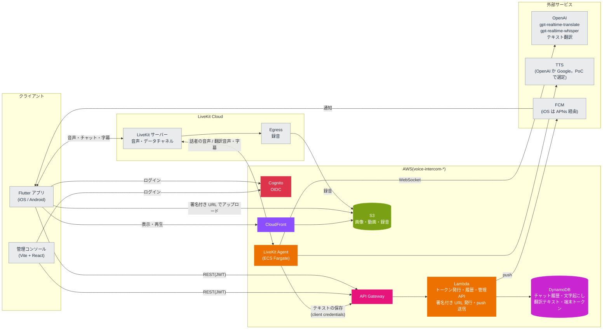

# voice-intercom

翻訳つきのボイスインカムアプリ。設計は [docs/設計メモ.md](docs/設計メモ.md) を参照。

## アーキテクチャ

音声・チャット・字幕は LiveKit で配信し、Agent が OpenAI で翻訳と文字起こしをする。履歴・メディア・トークン発行は AWS サーバーレスで持つ。



## 構成

| パス | 内容 | 開発する場所 |
| --- | --- | --- |
| `apps/mobile` | Flutter アプリ(iOS / Android) | ホスト |
| `apps/admin` | 管理コンソール(Vite + React) | devContainer |
| `services/agent` | LiveKit Agent(Python) | devContainer |
| `services/api` | API Gateway + Lambda(Python) | devContainer |
| `proto/` | データチャネルで流すメッセージの定義(Protobuf) | devContainer |
| `packages/schema/{python,ts,dart}` | `proto/` から生成した型。生成物もコミットする | 生成は devContainer |
| `packages/api-client/{ts,dart}` | REST API のクライアント。`services/api` の Pydantic のモデルから出した `openapi.json` をもとに生成する。生成物もコミットする | 生成は devContainer |
| `infra/` | Terraform(`envs/dev`、`envs/prod`。同じ AWS アカウントで名前を分ける) | devContainer |

## セットアップ

### ホスト(Apple Silicon の Mac)

1. Docker Desktop と [mise](https://mise.jdx.dev) を入れる(`brew install mise`)。
2. `cp .env.example .env` を実行し、`DEV_HOST` と `OIDC_ISSUER` をホストの LAN の IP に書き換える。
3. `mise install` を実行する(ローカルの LiveKit サーバー用)。Flutter を使うときは `apps/mobile` でも `mise install` を実行する。
4. Flutter の iOS ビルドには Xcode が必要。初回は `sudo xcodebuild -license` で同意しておく。

### devContainer

VS Code で「Reopen in Container」を選ぶ。初回に `.devcontainer/post-create.sh` が、ツールと依存関係(`uv sync`、`pnpm install`)を入れる。

## よく使うコマンド

| コマンド | 内容 | 実行する場所 |
| --- | --- | --- |
| `mise run gen` | proto から型を、REST API から OpenAPI とクライアントを生成する(`gen:proto`、`gen:api`)。Dart のクライアントの生成に使う Java は、初回にこのタスクが入れる | devContainer |
| `mise run lint` | buf lint、ruff、pyright、tsc | devContainer |
| `mise run fmt` | 整形 | devContainer |
| `mise run test` | pytest | devContainer |
| `mise run admin` | 管理コンソールの開発サーバーを起動する(`http://localhost:5173`) | devContainer |
| `mise run livekit` | ローカルの LiveKit サーバーを起動する(`--dev`、LAN に公開) | ホスト |
| `mise run build:api` | Lambda に載せるディレクトリ(`.build/api`)を作る | devContainer |
| `mise run build:agent` | Agent のイメージを linux/arm64 でビルドする(`voice-intercom-agent:local`) | devContainer |
| `mise run push:agent <env>` | Agent のイメージをビルドして ECR に push し、apply に渡すタグを表示する | devContainer |
| `mise run plan:dev` | `build:api` の後に、dev 環境の `terraform plan` を実行する | devContainer |
| `mise run local:init` | ローカルの DynamoDB と S3 に、テーブルとバケットを作る | devContainer |

## CI(GitHub Actions)

PR と main への push で動く。ツールは mise で `mise.toml` と同じ版を入れ、ジョブの中身は上の `mise run` のタスクと揃えてある。Flutter はまだ対象にしていない。

| ワークフロー | 動く条件 | 内容 |
| --- | --- | --- |
| `ci.yml` | 毎回 | `mise run lint`、`mise run test`、`buf breaking`(PR はベースブランチ、main への push は push 前と比べる) |
| `gen.yml` | proto、`services/api`、生成物、lock ファイル、`mise.toml` などが変わったとき | `mise run gen` の後に差分がないか(生成物が古ければ落ちる) |
| `terraform.yml` | `infra/` か `mise.toml` が変わったとき | `terraform fmt -check`、`envs/dev`・`envs/prod` の `init -backend=false` と `validate`(AWS には接続しない) |

- action はタグではなくコミット SHA で固定し、横にタグを書く。共通の準備(mise、uv、pnpm とそのキャッシュ)は `.github/actions/setup` にまとめてある。
- `terraform init` は lock ファイルを書き換えない(`-lockfile=readonly`)。プロバイダーを上げたら、`terraform providers lock -platform=linux_amd64 -platform=linux_arm64 -platform=darwin_arm64` で CI の分のハッシュも入れる。
- `gen.yml` と `terraform.yml` はパスで絞っているので、必須のチェックにすると、関係のない PR が待ち続ける。必須にするのは `ci.yml` のジョブだけにする。

## AWS(Terraform)

`infra/modules` に Cognito、DynamoDB、S3 + CloudFront(`media`)、API Gateway + Lambda(`api`)、LiveKit Agent の ECS Fargate(`agent`)のモジュールがあり、`infra/envs/<env>` から呼ぶ。

1. `.env` に `AWS_PROFILE` と `TF_STATE_BUCKET` を書き、`aws sso login` する。
2. 初回だけ `terraform -chdir=infra/envs/dev init -backend-config="bucket=$TF_STATE_BUCKET"` を実行する。state 用のバケットがまだなければ、先に `scripts/bootstrap-tfstate.sh` で作る(dev と prod で共用し、キーで分ける)。
3. `mise run plan:dev` で差分を確かめてから、`terraform -chdir=infra/envs/dev apply` する。
4. 初回の apply の後に、LiveKit の API シークレットを SSM に入れる(Terraform には値を持たせない)。

   ```sh
   aws ssm put-parameter --overwrite --type SecureString \
     --name /voice-intercom-dev/livekit/api-secret --value <secret>
   ```

LiveKit の URL と API キーは `TF_VAR_livekit_client_url`、`TF_VAR_livekit_api_key` で渡す。

### LiveKit Agent(ECS Fargate)

Agent は `services/agent/Dockerfile` のイメージ(linux/arm64)を、ECS Fargate(ARM64)で動かす。モジュールは `infra/modules/agent`。

1. 初回の apply では ECR などができるだけで、タスクは起動しない(`agent_image_tag` が空のうちは台数を 0 にする)。
2. OpenAI の API キーを SSM に入れる(LiveKit の API シークレットと同じく、Terraform には値を持たせない)。prod では LiveKit の API シークレットも同じように入れる。

   ```sh
   aws ssm put-parameter --overwrite --type SecureString \
     --name /voice-intercom-dev/openai/api-key --value <key>
   ```

3. コミットしてから、イメージを ECR に push する。最後に apply に渡すタグ(コミットのハッシュ)が表示される。

   ```sh
   mise run push:agent dev
   ```

4. タグを渡して apply する。タスクが起動し、LiveKit に登録する。ログは CloudWatch Logs の `/ecs/voice-intercom-dev-agent`。

   ```sh
   TF_VAR_agent_image_tag=<タグ> terraform -chdir=infra/envs/dev apply
   ```

SSM の値を変えたときは、新しいタスクでないと読み直さない。`aws ecs update-service --force-new-deployment --cluster voice-intercom-dev-agent --service voice-intercom-dev-agent` で入れ替える。dev を使わないときは `TF_VAR_agent_desired_count=0` で apply すると、Fargate の料金がかからない。

方針(理由の詳細は `infra/modules/agent` のコメント):

- **ネットワーク**: 環境ごとに VPC を作り、パブリックサブネットに public IP つきで置く。受信はセキュリティグループで全部閉じ、送信だけを許す。NAT Gateway(1つで月 45 USD ほど)と VPC エンドポイントは使わない。ヘルスチェックの 8081 はコンテナの中から叩くので開けない。
- **停止**: `stopTimeout` は Fargate の上限の 120 秒。Agent は `SIGTERM` で新しいジョブを断り、実行中のジョブを待つが、120 秒を超えるルームは切れ、約15秒で別のタスクに再ディスパッチされる。
- **デプロイ**: 新しいタスクを先に起動してから古いタスクを止める(minimum healthy 100% / maximum 200%)。起動しなければ前のタスク定義に戻す(サーキットブレーカー)。それでも実行中のルームは切れるので、**デプロイはルームの少ない時間にする**。AZ の偏りを直すためのタスクの入れ替え(AZ リバランシング)は切ってある。
- **台数**: 固定(dev は 1 vCPU・2GB を1つ、prod は 4 vCPU・8GB を1つ。prod を冗長にするなら `agent_desired_count` を 2 に)。オートスケールとスケールイン保護はまだ入れていない。スケールインのたびにルームが切れるのを防ぐには、ジョブを持つ間だけ Agent のコードから ECS のタスク保護(task-protection エンドポイント。保護中のタスクはデプロイでも止められない)を付ける必要があり、オートスケール(CPU 使用率のターゲット追跡、目標 50% 前後)はそれと一緒に入れる。Fargate Spot は、2分前の通知で止められるので使わない。

## REST API

`services/api`(API Gateway + Lambda)。`/health` 以外はアクセストークン(Bearer)が要る。管理者は `cognito:groups` に `admin` がある人。型の正は Pydantic のモデルで、仕様は [packages/api-client/openapi.json](packages/api-client/openapi.json)。

| エンドポイント | 内容 | 使える人 |
| --- | --- | --- |
| `GET /health` | 死活監視 | だれでも |
| `GET /rooms` | ルームの一覧(`{items}`) | 管理者はすべて、それ以外は自分がメンバーのルーム |
| `POST /rooms` | ルームを作る。同じ `room_id` があれば 409 | 管理者 |
| `GET /rooms/{room_id}` | ルームを取る | 管理者、メンバー |
| `PATCH /rooms/{room_id}` | 名前とメンバー(`member_ids`、Cognito の sub)を変える | 管理者 |
| `DELETE /rooms/{room_id}` | ルームを消す(204) | 管理者 |
| `GET /users/me` | 自分のプロフィール(表示名、言語)。未登録なら 404 | 本人 |
| `PUT /users/me` | プロフィールを登録・更新する | 本人 |
| `GET /users` | プロフィールを登録したユーザーの一覧(`{items}`) | 管理者 |
| `POST /livekit/token` | LiveKit の参加用トークン。プロフィールの表示名を name に、言語を参加者の属性 `language` に入れる。ルームがなければ 404、プロフィールが未登録なら 409 | 管理者、メンバー |

言語は gpt-realtime-translate が出力できる13言語のコード(`ja`、`en` など)。Agent の翻訳先はこの言語で決まるので、プロフィールがないとトークンを発行しない。

## ローカルの認証(模擬 OIDC サーバー)

本番は Cognito を標準の OIDC(認可コード + PKCE)で使う。ローカルでは、devContainer と一緒に起動する [mock-oauth2-server](https://github.com/navikt/mock-oauth2-server) に差し替える。

- issuer: `http://${DEV_HOST}:8090/default`(探索用の URL は `/.well-known/openid-configuration`)
- ログイン画面では任意のユーザー名と claims を入力できる。Cognito に寄せた claims の例:

  ```json
  { "cognito:groups": ["admin"], "token_use": "access", "client_id": "mobile" }
  ```

- client credentials(Agent から API を呼ぶとき)では、Cognito のアクセストークンと同じ形(`client_id`、`token_use`、`scope`)の claims を返す。設定は [.devcontainer/mock-oidc.json](.devcontainer/mock-oidc.json)。
- トークンの `iss` はリクエストの Host から決まる。そのため、クライアントは必ず `DEV_HOST` で接続する。コンテナ内から鍵(JWKS)を取るときは、`http://oidc:8090/default/jwks` を使う。

## 管理コンソール

`mise run admin` で起動し、ホストのブラウザで `http://localhost:5173` を開く(Cognito のリダイレクト先に合わせて、`localhost` で開く)。

- ログインは標準の OIDC(認可コード + PKCE)。ローカルでは模擬 OIDC のログイン画面が出るので、claims に次を入れる。`admin` グループがないと、ログインできても画面は見られない。

  ```json
  { "cognito:groups": ["admin"], "token_use": "access", "client_id": "admin", "email": "admin@example.com" }
  ```

- API は Vite が中継する(`/api` → `http://localhost:3000`)。同じオリジンになるので、ローカルでは CORS が要らない。
- 設定は `VITE_` で始まる環境変数で渡す。ローカルでは何も設定しなくてよい。

  | 変数 | 内容 | ローカルの既定 |
  | --- | --- | --- |
  | `VITE_OIDC_ISSUER` | トークンの iss | `.env` の `OIDC_ISSUER` |
  | `VITE_OIDC_CLIENT_ID` | OIDC のクライアント ID | `admin` |
  | `VITE_OIDC_LOGOUT_URL` | ログアウトの URL。Cognito では `<cognito_hosted_ui_url>/logout` | なし(探索で得た `end_session_endpoint`) |
  | `VITE_API_BASE_URL` | API の URL | `/api`(Vite の中継) |

- API がなくても画面を確かめられるよう、管理 API(ルームとユーザー)のモックがある。`VITE_API_MOCK=1 mise run admin` で起動すると、メモリ上のデータで応答する(ヘッダーに「モック API」と出る)。ログインは通常どおり模擬 OIDC を使う。
  - データは再読み込みで初期値に戻る。中身は `apps/admin/src/mockAdminApi.ts`。
  - エラーの表示は次で確かめられる。既にある ID でルームを作る(409)、ルーム `forbidden` を開く(403)、URL に無い ID を入れる(404)、ID `network-error` でルームを作る(通信の失敗)。
  - モックは開発サーバーでだけ有効になる。`pnpm build` では `VITE_API_MOCK` を設定しても読み込まれず、本番のビルドに入らない。
- AWS の dev 環境に向けるときは、`terraform output` の値(`oidc_issuer`、`cognito_client_ids.admin`、`cognito_hosted_ui_url`、`api_endpoint`)を、上の変数に渡す。API Gateway は `http://localhost:5173` からの CORS を許可している。

## ローカルの DynamoDB と S3

AWS に接続せずに API を動かせるように、devContainer と一緒に次の2つを起動する。データは名前付きボリュームに残る。

| 本番 | ローカル | 接続先 |
| --- | --- | --- |
| DynamoDB | [DynamoDB Local](https://hub.docker.com/r/amazon/dynamodb-local)(compose の `dynamodb`) | コンテナ内は `http://dynamodb:8000`、ホストからは `http://localhost:8000` |
| S3 + CloudFront | [SeaweedFS](https://github.com/seaweedfs/seaweedfs) の S3 API(compose の `s3`) | `http://${DEV_HOST}:8333` |

1. 初回と、ボリュームを消した後に `mise run local:init` を実行する。テーブル(`voice-intercom-local-timeline` / `-users` / `-rooms`)とバケット(`voice-intercom-local-media`)を作る。キーは `infra/envs/dev/main.tf` と揃えてある。DynamoDB Local はポイントインタイムリカバリの API がなく、Terraform のモジュールでは作れないので、スクリプトで作る。
2. API などを動かすときは、`scripts/with-local-aws.sh <起動コマンド>` で包む。接続先(`AWS_ENDPOINT_URL_DYNAMODB`、`AWS_ENDPOINT_URL_S3`)、ローカル用の鍵、テーブル名とバケット名(`TIMELINE_TABLE` など、Lambda と同じ名前)を環境変数で渡す。AWS SDK の標準の環境変数なので、アプリにローカル用の分岐は要らない。

注意:

- 接続先を `.env` に書かない。書くと、Terraform と aws CLI までローカルに向く。
- 署名付き URL は署名にホスト名を含むので、S3 の接続先は実機が届く `DEV_HOST` にしてある(コンテナ内からも `DEV_HOST` で届く)。
- CloudFront の代わりに、バケットを匿名で読めるようにしている(`MEDIA_BASE_URL` は `http://${DEV_HOST}:8333/voice-intercom-local-media`)。書き込みと一覧には鍵が要る。設定は [.devcontainer/seaweedfs-s3.json](.devcontainer/seaweedfs-s3.json)。
- 鍵を設定しているので、SeaweedFS も署名を確かめる。Content-Type が署名と違う PUT は、本番の S3 と同じく 403 になる。
- 起動直後の数秒は、S3 の読み取りが 500 を返すことがある(SeaweedFS の内部の登録待ち)。
