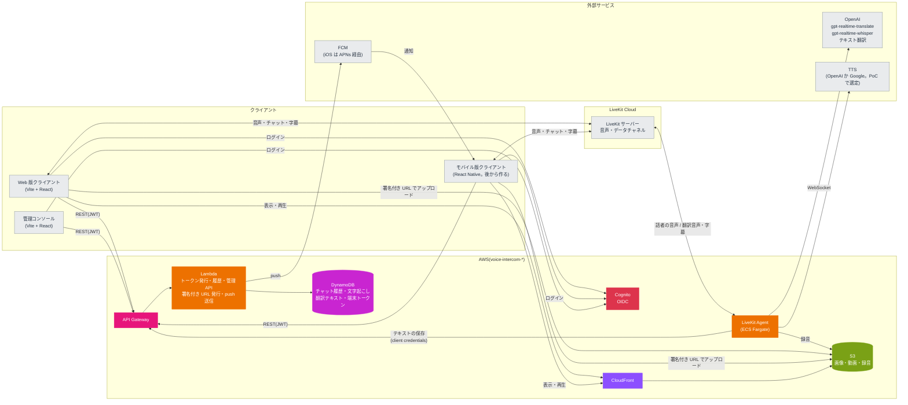

# voice-intercom

翻訳つきのボイスインカムアプリ。設計は [docs/設計メモ.md](docs/設計メモ.md) を参照。

## アーキテクチャ

音声・チャット・字幕は LiveKit で配信し、Agent が OpenAI で翻訳と文字起こしをする。履歴・メディア・トークン発行は AWS サーバーレスで持つ。



## 構成

| パス | 内容 | 開発する場所 |
| --- | --- | --- |
| `apps/admin` | 管理コンソール(Vite + React Router の SPA) | devContainer |
| `apps/web` | Web 版クライアント(Vite + React Router の SPA) | devContainer |
| `apps/mobile` | モバイル版クライアント(React Native)。Web 版がある程度できてから作る | ホスト |
| `services/agent` | LiveKit Agent(Python) | devContainer |
| `services/api` | API Gateway + Lambda(Python) | devContainer |
| `proto/` | データチャネルで流すメッセージの定義(Protobuf) | devContainer |
| `packages/schema/{python,ts}` | `proto/` から生成した型。生成物もコミットする | 生成は devContainer |
| `packages/client-core` | クライアントの画面を持たない処理(ルームの状態、字幕、テキスト入力、画像・動画の送受信と削除)。Web 版とモバイル版で使い回す。[packages/client-core/README.md](packages/client-core/README.md) | devContainer |
| `packages/design-tokens` | デザイントークン(色、角丸、書体)。3つのアプリで共有する。Tailwind のテーマと React Native の値を生成し、生成物もコミットする。[packages/design-tokens/README.md](packages/design-tokens/README.md) | 生成は devContainer |
| `packages/ui-web` | 管理コンソールと Web 版の UI 部品と、Tailwind の入口の CSS。画面を書くときの決まりもここ。[packages/ui-web/README.md](packages/ui-web/README.md)。部品の見本帳は `packages/ui-web/catalog`(`mise run catalog`) | devContainer |
| `packages/api-client/ts` | REST API のクライアント(TypeScript)。`services/api` の Pydantic のモデルから出した `openapi.json` をもとに生成する。生成物もコミットする | 生成は devContainer |
| `infra/` | Terraform(`envs/dev`、`envs/prod`。同じ AWS アカウントで名前を分ける) | devContainer |

## セットアップ

### ホスト(Apple Silicon の Mac)

1. Docker Desktop と [mise](https://mise.jdx.dev) を入れる(`brew install mise`)。
2. `cp .env.example .env` を実行し、`DEV_HOST` と `OIDC_ISSUER` をホストの LAN の IP に書き換える。
3. `mise install` を実行する。LiveKit サーバーは macOS 向けのバイナリが配布されていないので、ホストには入れず、`mise run livekit` が公式のイメージ(`livekit/livekit-server`)を Docker で動かす。版は `mise.toml` の `[vars]` の `livekit_version` で、devContainer の `livekit-server` と揃えてある。

### devContainer

VS Code で「Reopen in Container」を選ぶ。初回に `.devcontainer/post-create.sh` が、ツールと依存関係(`uv sync`、`pnpm install`)を入れる。

GitHub CLI(`gh`。版は `mise.toml`)を使うときは、初回に `gh auth login` でログインする(GitHub.com、HTTPS、ブラウザでの認証を選ぶ)。リポジトリは `InoueDaiki/voice-intercom`(Private)。

## よく使うコマンド

| コマンド | 内容 | 実行する場所 |
| --- | --- | --- |
| `mise run gen` | proto から型を、REST API から OpenAPI とクライアントを、デザイントークンから CSS と TS を生成する(`gen:proto`、`gen:api`、`gen:tokens`) | devContainer |
| `mise run lint` | buf lint、ruff、pyright、tsc(JS の各パッケージの `typecheck`)、oxlint(デザインの規則。`pnpm lint:design`) | devContainer |
| `mise run fmt` | 整形 | devContainer |
| `mise run test` | pytest(`test:py`)と、JS の Vitest(`test:js`) | devContainer |
| `mise run api` | REST API をローカルで起動する(`http://localhost:3000`。ローカルの DynamoDB・S3・模擬 OIDC につなぐ) | devContainer |
| `mise run admin` | 管理コンソールの開発サーバーを起動する(`http://localhost:5173`) | devContainer |
| `mise run web` | Web 版クライアントの開発サーバーを起動する(`http://localhost:5174`) | devContainer |
| `mise run catalog` | UI 部品とデザイントークンの見本帳(`packages/ui-web/catalog`)を起動する(`http://localhost:5175`) | devContainer |
| `mise run livekit` | ローカルの LiveKit サーバーを Docker で起動する(`--dev`、LAN に公開。ポートは 7880、7881、7882/udp) | ホスト |
| `mise run build:api` | Lambda に載せるディレクトリ(`.build/api`)を作る | devContainer |
| `mise run build:agent` | Agent のイメージを linux/arm64 でビルドする(`voice-intercom-agent:local`) | devContainer |
| `mise run push:agent <env>` | Agent のイメージをビルドして ECR に push し、apply に渡すタグを表示する | devContainer |
| `mise run plan:dev` | `build:api` の後に、dev 環境の `terraform plan` を実行する | devContainer |
| `mise run local:init` | ローカルの DynamoDB と S3 に、テーブルとバケットを作る | devContainer |

## CI(GitHub Actions)

PR と main への push で動く。ツールは mise で `mise.toml` と同じ版を入れ、ジョブの中身は上の `mise run` のタスクと揃えてある。

| ワークフロー | 動く条件 | 内容 |
| --- | --- | --- |
| `ci.yml` | 毎回 | `mise run lint`、`mise run test:py`、`mise run test:js`(別のジョブ)、`buf breaking`(PR はベースブランチ、main への push は push 前と比べる) |
| `gen.yml` | proto、`services/api`、生成物、lock ファイル、`mise.toml` などが変わったとき | `mise run gen` の後に差分がないか(生成物が古ければ落ちる) |
| `terraform.yml` | `infra/` か `mise.toml` が変わったとき | `terraform fmt -check`、`envs/dev`・`envs/prod` の `init -backend=false` と `validate`(AWS には接続しない) |

- action はタグではなくコミット SHA で固定し、横にタグを書く。共通の準備(mise、uv、pnpm とそのキャッシュ)は `.github/actions/setup` にまとめてある。
- `terraform init` は lock ファイルを書き換えない(`-lockfile=readonly`)。プロバイダーを上げたら、`terraform providers lock -platform=linux_amd64 -platform=linux_arm64 -platform=darwin_arm64` で CI の分のハッシュも入れる。
- `gen.yml`、`terraform.yml` はパスで絞っているので、必須のチェックにすると、関係のない PR が待ち続ける。必須にするのは `ci.yml` のジョブだけにする。

## AWS(Terraform)

`infra/modules` に Cognito、DynamoDB、S3 + CloudFront(`media`)、録音の S3(`recordings`)、API Gateway + Lambda(`api`)、LiveKit Agent の ECS Fargate(`agent`)のモジュールがあり、`infra/envs/<env>` から呼ぶ。

1. `.env` に `AWS_PROFILE` と `TF_STATE_BUCKET` を書き、`aws sso login` する。
2. 初回だけ `terraform -chdir=infra/envs/dev init -backend-config="bucket=$TF_STATE_BUCKET"` を実行する。state 用のバケットがまだなければ、先に `scripts/bootstrap-tfstate.sh` で作る(dev と prod で共用し、キーで分ける)。
3. `mise run plan:dev` で差分を確かめてから、`terraform -chdir=infra/envs/dev apply` する。
4. 初回の apply の後に、LiveKit の API シークレットを SSM に入れる(Terraform には値を持たせない)。

   ```sh
   aws ssm put-parameter --overwrite --type SecureString \
     --name /voice-intercom-dev/livekit/api-secret --value <secret>
   ```

5. push 通知(FCM)のサービスアカウントの JSON を SSM に入れる。Firebase コンソールの「プロジェクトの設定 > サービス アカウント」で秘密鍵(JSON)を作り、ファイルのまま入れる(`file://` で読ませると改行も崩れない)。入れたらファイルは消す。

   ```sh
   aws ssm put-parameter --overwrite --type SecureString \
     --name /voice-intercom-dev/fcm/service-account --value file://service-account.json
   ```

   API の Lambda は実行環境が立ち上がるときに1回だけ読む。値を入れ替えたら、Lambda のコードか設定を更新して実行環境を入れ替える。値が初期値(`CHANGE_ME`)のままだと、通知を送るところでエラーになる。

LiveKit の URL と API キーは `TF_VAR_livekit_client_url`、`TF_VAR_livekit_api_key` で渡す。

### Cognito のログイン画面

ログイン画面は Cognito のマネージドログイン(ドメインの `managed_login_version = 2`)。

- 見た目はデザイントークンから作る。`packages/design-tokens` の `mise run gen:tokens` が `generated/cognito-branding.json` を作り、`infra/modules/cognito` がクライアント(`mobile`・`web`・`admin`)ごとに当てる。色を変えたら、gen と apply をする。反映まで数分かかる。
- ログイン画面を使うクライアントを足すときは、`aws_cognito_managed_login_branding` にも足す(Terraform で作ったクライアントには見た目が付かず、ログイン画面が出ない)。
- 言語は `/oauth2/authorize` の `lang` で決まる(無いと英語)。Web 版はブラウザの言語から選び、管理コンソールは `ja`。

### LiveKit Agent(ECS Fargate)

Agent は `services/agent/Dockerfile` のイメージ(linux/arm64)を、ECS Fargate(ARM64)で動かす。モジュールは `infra/modules/agent`。

1. 初回の apply では ECR などができるだけで、タスクは起動しない(`agent_image_tag` が空のうちは台数を 0 にする)。
2. OpenAI の API キーを SSM に入れる(LiveKit の API シークレットと同じく、Terraform には値を持たせない)。prod では LiveKit の API シークレットも同じように入れる。

   ```sh
   aws ssm put-parameter --overwrite --type SecureString \
     --name /voice-intercom-dev/openai/api-key --value <key>
   ```

   dev では、Agent が履歴を保存する(確定した字幕を API に PUT する)ときに使う、Cognito の Agent のクライアントシークレットも SSM に入れる。値は Cognito が作るので、Terraform の出力(sensitive)から写す。Terraform のタスク定義には SSM のパラメーターの ARN だけを渡す(OpenAI のキーと同じ)。シークレットの値は Cognito のクライアントのリソースとして state に入っているが、SSM のパラメーターの値としては持たせない。prod にはまだ Cognito と API が無いので、履歴は保存しない(`history = null`)。

   ```sh
   aws ssm put-parameter --overwrite --type SecureString \
     --name /voice-intercom-dev/cognito/agent-client-secret \
     --value "$(terraform -chdir=infra/envs/dev output -raw agent_client_secret)"
   ```

   Cognito のクライアントを作り直したとき(シークレットが変わる)も、同じコマンドで入れ直し、下の `update-service` でタスクを入れ替える。

3. コミットしてから、イメージを ECR に push する。最後に apply に渡すタグ(コミットのハッシュ)が表示される。

   ```sh
   mise run push:agent dev
   ```

4. タグを渡して apply する。タスクが起動し、LiveKit に登録する。ログは CloudWatch Logs の `/ecs/voice-intercom-dev-agent`。

   ```sh
   TF_VAR_agent_image_tag=<タグ> terraform -chdir=infra/envs/dev apply
   ```

SSM の値を変えたときは、新しいタスクでないと読み直さない。`aws ecs update-service --force-new-deployment --cluster voice-intercom-dev-agent --service voice-intercom-dev-agent` で入れ替える。dev は scale to zero にしてあり(下の「台数」)、使っていない間は 0 台で Fargate の料金がかからない。入室しても起こさないようにするには `TF_VAR_agent_max_count=0` で apply する。

方針(理由の詳細は `infra/modules/agent` のコメント):

- **ネットワーク**: 環境ごとに VPC を作り、パブリックサブネットに public IP つきで置く。受信はセキュリティグループで全部閉じ、送信だけを許す。NAT Gateway(1つで月 45 USD ほど)と VPC エンドポイントは使わない。ヘルスチェックの 8081 はコンテナの中から叩くので開けない。
- **停止**: `stopTimeout` は Fargate の上限の 120 秒。Agent は `SIGTERM` で新しいジョブを断り、実行中のジョブを待つが、120 秒を超えるルームは切れ、約15秒で別のタスクに再ディスパッチされる。そのため、ジョブを持つタスクには下のタスク保護を付け、スケールインとデプロイでは止めさせない。
- **デプロイ**: 新しいタスクを先に起動してから古いタスクを止める(minimum healthy 100% / maximum 200%)。起動しなければ前のタスク定義に戻す(サーキットブレーカー)。AZ の偏りを直すためのタスクの入れ替え(AZ リバランシング)は切ってある。タスク保護との関係は次のとおり。
  - ジョブを持つ古いタスクは、保護が外れるまで止められない。新しいタスクは起動し(maximum 200% なので、保護中の古いタスクと並べられる)、デプロイは古いタスクが止まるまで `IN_PROGRESS` のまま続く。ECS は、保護中のタスクがデプロイを止めているとサービスのイベントで知らせる。
  - サーキットブレーカーは、新しいタスクが `RUNNING` にならない回数とヘルスチェックの失敗の回数だけを数え、デプロイにかかる時間では打ち切らない。古いタスクが保護で残っていても失敗にもロールバックにもならない。`terraform apply` はデプロイの完了を待たない(`wait_for_steady_state` を使っていない)。
  - 保護中の古いタスクも LiveKit には登録したままなので、新しいルームを受けることがある。ルームが絶えないと保護が延長され続けるので、Agent は保護を続ける長さに上限(`TASK_PROTECTION_MAX_HOURS`、既定 12 時間)を置き、過ぎたら延長をやめる。期限(既定 60 分)が切れると古いタスクは止められ、残っていたルームは 120 秒で切れて新しいタスクに再ディスパッチされる。つまり、デプロイはルームが無くなりしだい終わり、長くても約 13 時間で終わる。
  - 前のデプロイが終わる前に次のデプロイを始めると、ロールバック先(`COMPLETED` のデプロイ)が無く、サーキットブレーカーが戻せないことがある。`aws ecs describe-services` の `deployments[].rolloutState` が `COMPLETED` になってから次を出す。急ぐなら、ルームの少ない時間に出す。
- **dev の台数(scale to zero)**: dev はオートスケールを使わず、0 台と 1 台を切り替える(`agent_idle_shutdown_minutes`、既定 15。0 にすると下の prod と同じオートスケールになる)。決めた理由は設計メモの「Agent の scale to zero」。
  - **起こす**: 入室のトークン(`POST /livekit/token`)を出すときに、API がサービスの台数が 0 なら 1 にする(`services/api` の `agent_wake.py`。Lambda に `ecs:DescribeServices`・`ecs:UpdateService` を許す)。起動して LiveKit に登録するまで 1〜2 分かかり、その間アプリは「翻訳の準備中」と出し、テキストは送らずに待つ(3 分まで)。
  - **割り当て直す**: LiveKit は、Agent が1台も登録していないときに作られたルームの割り当てを、後から登録した Agent に渡さない(ローカルの livekit-server 1.13.9 で確かめた)。そこで Agent は登録した 5 秒後に、人がいて Agent のいないルームを探し、`CreateDispatch` で割り当て直す(`services/agent` の `scale_to_zero.py`)。ローカルでは、入室の 30 秒後に起動した Agent が、その 9 秒後にルームに入った。
  - **止める**: ジョブの無い状態が 15 分続き、人のいるルームも無ければ、Agent が自分のサービスの台数を 0 にする(タスクロールに自分のサービスへの `ecs:UpdateService` を許す)。止めた直後に入った人のルームには Agent がいないが、入り直せば起こし直す。
  - `agent_image_tag` が空の間と、`agent_max_count` が 0 のときは、API は起こさない。
- **prod の台数**: CPU 使用率(サービスのタスクの平均)のターゲット追跡でオートスケールする。目標は 50%(`cpu_target_percent`)、スケールアウトの後は 120 秒、スケールインの後は 900 秒待つ。dev は 1 vCPU・2GB(scale to zero で 0〜1 つ)、prod は 4 vCPU・8GB を 1〜4 つ。prod を冗長にするなら `agent_min_count` を 2 に。最小を 0 にすると、CPU の指標が出ないので 0 台から増えない(止めたいときだけ `agent_max_count` を 0 にする)。台数はオートスケールが変えるので、Terraform はサービスの `desired_count` を作るときにしか使わない(`ignore_changes`)。`agent_image_tag` が空の間は最大を 0 にし、0 台にする。Fargate Spot は、2分前の通知で止められるので使わない。
  - **CPU の目標と LiveKit の負荷の閾値**: LiveKit のワーカーは、自分の CPU 使用率(cgroup で測る、2.5 秒の移動平均)が `load_threshold`(本番の既定 0.7)以上になると「満杯」になり、新しいジョブを断る(LiveKit はほかのワーカーに回す)。ECS の指標は 1 分ごとの全タスクの平均なので、目標を閾値と同じ 70% にすると、平均が届く前に一部のタスクが断り始め、増えるのも遅れる。タスクの起動と LiveKit への登録にも 1〜2 分かかるので、目標は閾値より低い 50% にして早めに増やす(設計メモの「0.5 付近で早めにスケールアウト」)。目標を上げるなら、閾値(70%)より下に収める(変数の検証で 70 未満に制限している)。
- **録音**: Agent は話者ごと・発話ごとの録音(Ogg/Opus)を、録音用のバケット `voice-intercom-<env>-recordings-<アカウント ID>`(`infra/modules/recordings`)に置く。キーは `rooms/<room_id>/<YYYY>/<MM>/<DD>/<utterance_id>-<speaker_id>.ogg`(詳しくは `services/agent/README.md` の「録音」)。LiveKit の Egress は使わない(固定費を抑えるため。設計メモの「録音の方式」)。
  - 画像・動画のバケット(media)には置かない。media は CloudFront の既定の振る舞いがバケット全体を署名なしで配信するので、キーが分かれば誰でも聞けてしまう。録音のバケットは CloudFront につながず、パブリックアクセスをすべてブロックし、SSE-S3 で暗号化し、HTTPS 以外を拒む。
  - タスクロールには `rooms/*` への `s3:PutObject` だけを許す(読み取り・一覧・削除はできない)。タスク定義に `RECORDING_BUCKET` と `AWS_DEFAULT_REGION` を渡す。聞くときは、管理者の権限で `aws s3 cp` などで取り出す。
  - 古い録音はライフサイクルで消す。日数は `recording_retention_days`(dev 30日、prod 90日)。途中で止まったマルチパートアップロードは1日で消す。
  - Agent が落ちている間、デプロイやスケールインで 120 秒を超えたルームが切られた後、再ディスパッチまでの約15秒は録れない。この抜けは許容する。
  - S3 へは public IP から出る(VPC エンドポイントは作っていない。S3 のゲートウェイ型エンドポイントは無料なので、必要になったら足せる)。
- **タスク保護**: Agent はジョブ(ルーム)を持つ間だけ、ECS のタスクのスケールイン保護を付ける(`services/agent/src/voice_intercom_agent/task_protection.py`)。コンテナの中の ECS エージェントのエンドポイント(`$ECS_AGENT_URI/task-protection/v1/state`)を使い、ECS エージェントはタスクロールの権限(`ecs:UpdateTaskProtection`・`ecs:GetTaskProtection`。モジュールで付ける)で ECS の API を呼ぶ。
  - ジョブが 0 から 1 以上になったら付け、0 に戻ったら外す。期限は 60 分(`TASK_PROTECTION_EXPIRES_MIN`、最大 2880 分)にして、ジョブがある間は 20 分ごと(`TASK_PROTECTION_RENEW_MIN`)に延長する。Agent が落ちても、保護は最長 60 分で切れる。
  - スケールインは保護の付いていないタスクからしか止めない。ルームが少ないうちは各タスクに散らばるので、CPU が下がっても台数が減らないことがある。
  - 保護の付け外しに失敗しても(権限、`DEPLOYMENT_BLOCKED` など)、ジョブは止めずにログに残し、30 秒後にやり直す。`ECS_AGENT_URI` の無いローカルでは何もしない。

## REST API

`services/api`(API Gateway + Lambda)。`/health` 以外はアクセストークン(Bearer)が要る。管理者は `cognito:groups` に `admin` がある人。型の正は Pydantic のモデルで、仕様は [packages/api-client/openapi.json](packages/api-client/openapi.json)。

| エンドポイント | 内容 | 使える人 |
| --- | --- | --- |
| `GET /health` | 死活監視 | だれでも |
| `GET /rooms` | ルームの一覧(`{items}`) | 管理者はすべて、それ以外は自分がメンバーのルーム |
| `POST /rooms` | ルームを作る。同じ `room_id` があれば 409。同じ `room_id` の前のルームの履歴とメディアが残っていれば消す | 管理者 |
| `GET /rooms/{room_id}` | ルームを取る | 管理者、メンバー |
| `PATCH /rooms/{room_id}` | 名前とメンバー(`member_ids`、Cognito の sub)を変える。`member_ids` は user_id の順で返す。外した人が LiveKit のルームにいれば出す | 管理者 |
| `DELETE /rooms/{room_id}` | ルームを消す(204)。LiveKit のルームを消して全員(Agent も)を切り、履歴(timeline)と S3 の `rooms/<room_id>/` を消して CloudFront を無効にする。無いルームは 404 だが、後始末はやり直す | 管理者 |
| `GET /users/me` | 自分のプロフィール(表示名、言語)。未登録なら 404 | 本人 |
| `PUT /users/me` | プロフィールを登録・更新する | 本人 |
| `PUT /users/me/devices` | push 通知の端末トークンを登録する(`{token, platform: "ios" \| "android"}`、204)。アプリの起動時とトークンの更新時に呼ぶ | 本人 |
| `DELETE /users/me/devices` | 端末トークンを外す(本文に `{token}`、204)。ログアウトのときに呼ぶ。登録されていなくても 204 | 本人 |
| `GET /users` | プロフィールを登録したユーザーの一覧(`{items}`) | 管理者 |
| `POST /livekit/token` | LiveKit の参加用トークン。プロフィールの表示名を name に、言語を参加者の属性 `language` に入れる。Agent のディスパッチ(`AGENT_NAME`、既定 `voice-intercom`)も入れ、ルームが作られたときに Agent が入る。ルームがなければ 404、プロフィールが未登録なら 409 | 管理者、メンバー |
| `GET /rooms/{room_id}/timeline` | ルームの履歴(`{items, next_before}`)を新しい順に。`limit`(1〜100、既定 50)と `before`(前の応答の `next_before`)でページングする | 管理者、メンバー |
| `GET /rooms/{room_id}/timeline/event?event_id=...` | 履歴の1件(強い整合の読み取り)。消した行は墓石(`deleted` 付き)で返す。無ければ 404 | 管理者、メンバー |
| `DELETE /rooms/{room_id}/timeline/event?event_id=...` | 送ったテキスト入力か画像・動画を消す。行は残して墓石にし(`deleted` を付け、`text`・`translations`・`media` は空)、2回目からは同じ墓石を返す。今ルームにいる人へデータチャネル(topic `deletion`)で知らせ、画像・動画なら S3 の本体とサムネイルを消して CloudFront のキャッシュを無効にする。他人の行と音声の発話は 403 | 送った本人 |
| `PUT /rooms/{room_id}/timeline/{source_id}` | 発話(`utterance`、字幕の区切りごと)かテキスト入力(`text`。アプリが振った `message_id` も持つ)を履歴に保存する。`event_id` は `<occurred_at>#<source_id>` で、同じなら置き換える(再送しても1件)。消した行(墓石)は置き換えず、墓石を返す | Agent |
| `POST /rooms/{room_id}/media/uploads` | 画像・動画・ファイルを S3 に PUT する署名付き URL(本体と、`has_thumbnail` ならサムネイル)。`content_type` は MIME タイプなら何でもよく、画像4種は画像、`video/*` は動画、それ以外はファイル(`file_name` も送る)。ファイルは `content_disposition` も返す。期限は1時間。`size_bytes` は 10GB まで。16MB 以上ならマルチパートにし、`upload_url` の代わりに `multipart`(`part_size`・`part_count`)を返す。送信者が測った `width`・`height`(1〜65535、両方か無し)と、動画なら `duration_ms`(1〜86,400,000)を任意で送り、履歴に入れる | 管理者、メンバー |
| `POST /rooms/{room_id}/media/{media_id}/parts` | マルチパートのパートを PUT する署名付き URL(`part_numbers` で 100 個まで、期限1時間。`thumbnail: true` ならサムネイルの URL も取り直す)。マルチパートでない・保存した後は 409 | アップロードした本人 |
| `POST /rooms/{room_id}/media/{media_id}/complete` | 1回の PUT なら本文なし。マルチパートなら `parts`(全パートの `part_number` と `etag`)を送り、API が完了させる。アップロードした画像・動画・ファイルを履歴(`media`)に保存し、今ルームにいる人へデータチャネル(topic `media`)で配信する。最初の complete では、ルームにいないメンバーに push 通知も送る。本体かサムネイルがまだ置かれていない、大きさが申告と違えば 409。マルチパートを完了できなければ 410(uploads からやり直す)。2回目からは同じ履歴を返し、配信だけをやり直す | アップロードした本人 |
| `POST /rooms/{room_id}/notifications/speaking` | 誰かが話し始めたことを push 通知する(`{speaker_id, present_ids}`)。ルームのメンバーから話者と `present_ids` を除いた人に送り、`{sent, skipped}` を返す。同じルーム × 同じ受け手には `NOTIFY_INTERVAL_S`(既定 300 秒。テキスト・画像・動画の通知と共通)に1回まで。ルームがなければ 404。送信に失敗しても 500 にせず `sent: 0` | Agent |
| `POST /rooms/{room_id}/notifications/text` | テキスト入力が届いたことを push 通知する(`{sender_id, present_ids, text}`)。本文は「<表示名>さん: <テキストの先頭50文字>」。宛先・間引き・応答は `notifications/speaking` と同じ | Agent |

言語は gpt-realtime-translate が出力できる13言語のコード(`ja`、`en` など)。Agent の翻訳先はこの言語で決まるので、プロフィールがないとトークンを発行しない。

Agent は client credentials のトークン(スコープ `voice-intercom/agent`)で呼ぶ。Agent のトークンは利用者向けのエンドポイントでは 403、`PUT .../timeline/...` と `POST .../notifications/...` は利用者のトークンでは 403 になる。

画像・動画・ファイルのアップロード:

1. `POST .../media/uploads` に `content_type`(MIME タイプ)と `size_bytes`、ファイルなら `file_name`(と、画像・動画で測れれば `width`・`height`・`duration_ms`)を送り、`upload_url`(16MB 以上なら `multipart`)をもらう。
2. `upload_url` に本体を PUT する。**Content-Type ヘッダーを `content_type` と同じにする**(署名に含めてあり、違うと S3 も SeaweedFS も 403)。**ファイルは Content-Disposition ヘッダーを応答の `content_disposition` にする**(これも署名に入っている)。サムネイルは `thumbnail_upload_url` に `image/jpeg` で PUT する。
   - マルチパートなら、`POST .../media/{media_id}/parts` でパートの URL を取り、パート n(ファイルの `(n-1)*part_size` バイト目から `part_size` バイト。最後は残り)を PUT する。Content-Type は要らない。応答の `ETag` ヘッダーを覚えておく。パートは並べて送ってよく、失敗したパートは同じ番号で送り直せばよい。
3. `POST .../media/{media_id}/complete` を呼ぶ(マルチパートなら `parts` に全パートの番号と ETag)。履歴の `media.url`(CloudFront)で表示・再生する。

- **種類(`media.media_type`)**: `image/jpeg`、`image/png`、`image/webp`、`image/heic` は `image`、`video/*` は `video`(ブラウザが送る MOV なども)、それ以外はすべて `file`。形式は問わず、上限は同じ 10GB。GIF も `file` になる(アプリが表示できる形式だけを画像にする)。
- **ファイルはダウンロードだけ**: `Content-Disposition: attachment; filename="<ASCII の代わりの名前>"; filename*=UTF-8''<元の名前>` でオブジェクトを置く(1回の PUT は署名に含め、マルチパートは API が CreateMultipartUpload で付ける)。CloudFront は署名なしで配信するので、HTML や SVG をブラウザで開かせると、配信のドメインで任意のページを見せられてしまうため。ウイルス検査はしていない(設計メモの「ファイルの送信」)。
- **ファイル名**: `file_name` はパスを除いた名前だけにし、制御文字を除く(255 文字まで)。履歴の `media.file_name` と `MediaMessage.file_name` に入る。ファイルにはサムネイルと幅・高さを付けられない(422)。

- 画像・動画には文を添えられない(翻訳などを考えないため。設計メモの「画像・動画のルームへの配信」)。前に受け付けていた complete の `text` は、送られても無視する(Pydantic の既定で知らない項目を捨てる。REST API は未リリースだが、作りかけのクライアントが 422 にならないように)。履歴の media の行は `text` が常に空、`language` が常に null で、前に文を添えて保存した行も読むときに空にする。
- `width`・`height`・`duration_ms` は、送信者のアプリが整えた後の本体で測った値(向きを反映した後)。API は中身を読んで確かめず、範囲だけを確かめる。`duration_ms` は動画のときだけ。履歴の `media` にそのまま入り、送らなかった行(足す前の行、管理コンソールから上げたもの)は null。

- 本体の上限は 10GB。16MB 以上はマルチパートで、パートは 8MB(10,000 個を超えるなら 1MB 単位で大きくする。10GB では 1,280 個)。理由は設計メモの「画像・動画のアップロード」。署名付き URL では大きさを縛れないので、complete で置かれた大きさが `size_bytes` と同じかを確かめる。
- マルチパートの UploadId はクライアントに返さず、仮の行に持つ。Content-Type は uploads の CreateMultipartUpload で決まる。未完了のマルチパートは、ライフサイクルルール(`infra/modules/media`)が1日で消す。仮の行も1日で消えるので、マルチパートは1日のうちに complete する。
- complete は、サムネイルを先に確かめてから(無ければ 409)、CompleteMultipartUpload を呼ぶ。パートが合わない(ETag 違い)・アップロードが無い・完了した本体の大きさが違うときは、アップロードを取りやめて(完了した後なら本体を消して)410。前の complete が完了させた後に応答を失ったときは、S3 が NoSuchUpload を返すので、本体があればそのまま保存に進む。
- 消した画像・動画は、マルチパートも取りやめる(Lambda に `s3:AbortMultipartUpload` を許してある)。消した後に complete が呼ばれたら、墓石を返し、S3 の本体とサムネイルを消し直す。
- ローカルの SeaweedFS(4.48)も、パートの署名付き URL、CompleteMultipartUpload、AbortMultipartUpload に対応している(2026-10-14 に確かめた。設計メモの「画像・動画のアップロード」)。
- S3 のキーは `rooms/<room_id>/<media_id>/original` と `.../thumbnail`。
- complete を呼べる人は、uploads のときに timeline テーブルへ書く仮の行(`room_id` が `media-upload#<room_id>`。履歴には出ない。1日で TTL が消す)で確かめる。理由は `services/api` の `media.py` のコメント。
- CloudFront の URL は署名なしで読める。`media_id` は推測できない乱数(UUID4)にしている。

### 画像・動画のルームへの配信

complete で履歴に保存した後に、API が LiveKit の Server API でルームに知らせる(`services/api` の `media_broadcast.py`。決めた理由は設計メモの「画像・動画のルームへの配信」)。

1. `ListParticipants` で今ルームにいる人(kind が `STANDARD`)を取る。
2. 1人以上いれば、`SendData` で topic `media`、reliable、宛先なし(送信者本人を含む全員)に `MediaMessage`(`proto/voiceintercom/v1/media.proto`)を送る。中身は complete の応答(履歴の行)と同じで、`width`・`height`・`duration_ms` も入れる(分からなければ 0)。`text`・`text_truncated`・`language` は使わない(常に空。古いアプリのために項目は残し、`deprecated` にした)。
3. 最初の complete のときだけ、ルームのメンバーから送信者と今ルームにいる人を除いた人に push 通知を送る。タイトルはルームの名前、本文は「<表示名>さんが画像を送りました」(動画なら「動画を送りました」)、data は `{"type": "media", "room_id": ..., "event_id": ...}`。同じルーム × 同じ受け手には、テキスト・話し始めと共通の間隔(5分)に1回まで(「push 通知」)。

- 配信や通知が失敗しても complete は 200 で履歴を返す(ログに残す)。`ListParticipants` が失敗したら配信を飛ばし、push 通知は送信者以外の全員に送る。
- LiveKit の呼び出しは1回2秒、push 通知は8秒で待つのをやめる(Lambda の timeout 15秒に収める)。
- Server API の URL は `LIVEKIT_CLIENT_URL`(SDK が `wss://` を `https://` に読み替える)。ローカルでは、API(devContainer)から `DEV_HOST` の LiveKit に届く。

アプリが受け取るとき:

- topic `media` のデータを `MediaMessage` として読む。同じ `event_id` が2回以上届くことがある(complete のやり直し)ので、`event_id` で重複を捨てる。自分の送ったものも届く。
- 送信元の参加者があるデータは捨てる(参加者は topic を偽れる)。送信元の参加者が無いだけではサーバーから来たとは言えない(入った直後の参加者のデータも無しで届く)ので、表示の前に履歴(`GET /rooms/{room_id}/timeline`)で `event_id` の行を確かめ、表示には履歴の行を使う(設計メモの「誰がルームに知らせるか」)。Flutter 版のアプリはこの形で受けていた(タグ `flutter-final` の `apps/mobile/README.md` の「受ける(ルームへの配信)」)。

### 送ったものの削除

送った本人は、テキスト入力と画像・動画を `DELETE .../timeline/event` で消せる(音声の発話は消せない。決めた理由は設計メモの「送ったものの削除」)。`services/api` の `timeline.py` と `deletion.py`。

- 履歴の行は消さずに墓石にする。一覧(`GET .../timeline`)でも、その場所に `deleted`(`deleted_at`、media なら `media_type`: `image` / `video`)の付いた行が出る。本文・訳・URL は返さない。
- 消した後に、画像・動画の配信と同じく `ListParticipants` と `SendData` で topic `deletion`、reliable に `DeletionMessage`(`proto/voiceintercom/v1/deletion.proto`)を送る。受け手は送信元の参加者があるものを捨て、無いものも `GET .../timeline/event` で行が消されていることを確かめてから表示を変える(なりすましで他人のものを消したように見せられない)。
- 画像・動画は、S3 の本体とサムネイルを消し、CloudFront を `/rooms/<room_id>/<media_id>/*` の1パスで無効にする(`MEDIA_DISTRIBUTION_ID`。ローカルでは空で、無効化を飛ばす)。Lambda には `s3:DeleteObject` と `cloudfront:CreateInvalidation` を許してある。
- 知らせや後始末が失敗しても DELETE は 200 で墓石を返す。もう一度呼べばやり直す。push 通知は取り消さない。

### メンバーを外したとき・ルームを消したとき

入室の権限は LiveKit のトークンを出すときにしか確かめず、接続した後のトークンは LiveKit サーバーが更新し続ける。そのため API が LiveKit の Server API で後始末をする(`services/api` の `room_cleanup.py`。決めた理由は設計メモの「メンバーを外したとき・ルームを消したときの後始末」)。

- メンバーを外したら、`ListParticipants` で今ルームにいる人を取り、外した人を `RemoveParticipant` で出す。管理者もメンバーから外せば出る(入り直せる)。
- ルームを消したら、`DeleteRoom` で全員(Agent も)を切り、timeline テーブルのルームのパーティション(履歴、`media-upload#<room_id>`、`notify#<room_id>`)と S3 の `rooms/<room_id>/` の下(途中のマルチパートも)を消し、CloudFront を `/rooms/<room_id>/*` で無効にする。録音のバケットは消さない。
- 後始末が失敗しても、PATCH と DELETE は成功で返す(ログに残す)。履歴とメディアの削除は6秒で打ち切り、残りは同じ `room_id` でルームを作るとき(か DELETE のやり直し)に消す。
- Lambda には `s3:ListBucketMultipartUploads` も許してある(ほかは画像・動画の削除と同じ権限)。
- 出した人も、出す前に受け取ったトークン(15分)で入り直すことはできる(アプリは入り直さない)。

### push 通知

端末トークンは users テーブルの項目(`devices`)に持たせる。詳しくは `services/api/src/voice_intercom_api/device_store.py` と `devices.py`。

- 解除はトークンを本文で渡す。FCM のトークンは長く `:` などを含み、知っていればその端末に通知を送れるので、URL(パス)には出さない。
- 1人 10 台まで。超えたら、最後に登録した時刻がいちばん古い端末を外す(再インストールで残った古いトークンから外れる)。
- 同じトークンを別の人が登録したら、前の人から外す(ログアウトせずに別の人がログインした端末に、前の人の通知が届かないように)。
- プロフィールの登録より先に端末を登録してもよい。プロフィールが未登録のうちは `GET /users/me` は 404 のまま。

送るのは `voice_intercom_api.notify` の `send_to_users`。

どこから送るか: ルームに何か届いたら(テキスト入力、音声の話し始め、画像、動画)、今ルームに入っていないメンバーに送る。タイトルはどれもルームの名前。

- 話し始め: Agent が `POST /rooms/{room_id}/notifications/speaking` を呼んで送る(`services/api` の `notifications.py`)。本文は「<話者の表示名>さんが話しています」(プロフィールが無ければ「誰かが話しています」)、data は `{"type": "speaking", "room_id": ...}`。
- テキスト入力: テキストはデータチャネルで Agent にだけ届くので、Agent が受け付けたときに `POST /rooms/{room_id}/notifications/text` を呼んで送る。本文は「<表示名>さん: <テキストの先頭50文字>…」(改行は空白に。プロフィールが無ければ「誰か: …」。原文のまま)、data は `{"type": "text", "room_id": ...}`。
- 画像・動画: complete から API が送る(「画像・動画のルームへの配信」)。

- 送る相手は、ルームの `member_ids` から、送信者(`speaker_id`、`sender_id`)と `present_ids`(今ルームに入っている人)を除いた人。
- 同じルーム × 同じ受け手には、`NOTIFY_INTERVAL_S` 秒(既定 300)に1回まで。最初の1件はすぐ送る。種類(テキスト・話し始め・画像・動画)は分けずに数え、別のルームは別に数える(`room_push.py`)。間隔の内側の人は `skipped` に数える。受け手ごとの最後の送信時刻は timeline テーブルの別のパーティション(`room_id` が `notify#<room_id>`、`event_id` が受け手の sub。履歴には出ない)に置き、条件付きの UpdateItem(前回が間隔より前なら更新)で決めるので、同時に呼ばれても二重に送らない。テーブルを増やさず、メディアの仮の行と同じく TTL で消える。
- `sent` は送り終えた人数(端末を登録していない人、FCM が失敗した人も含む)。サービスアカウントが未設定・読めない、FCM の呼び出しが例外になった、などのときはログに残して `sent: 0` を返し、取った時刻を戻す(次の呼び出しで送れる)。
- 送信は 10 秒で打ち切って応答する(Lambda の timeout 15 秒に収めるため)。Lambda は応答を返すと実行環境を止めるので、まだ始めていない送信はせず、送り終えなかった受け手は `sent` に数えずに時刻を戻す(次の呼び出しで送れる)。Agent は応答を待たずに次へ進む前提。

ほかの場所から送るときの例:

```python
from voice_intercom_api import notify

# だれに送るか(送り主を除く、など)は呼び出し側で決める
recipients = [uid for uid in room.member_ids if uid != sender_id]
result = notify.send_to_users(
    recipients,
    title=room.name,
    body=f"{sender_name}: {text}",
    data={"type": "chat", "room_id": room.room_id},  # 値は文字列だけ
)
```

- Android は高優先度、iOS は通常の alert 通知で送る。FCM HTTP v1 は1トークンに1リクエストなので、並べて送る(同時に 8 本)。
- FCM が `UNREGISTERED` か、トークンが原因の `INVALID_ARGUMENT` を返したトークンは users から消す。それ以外の失敗(5xx、429、通信の失敗)はやり直さず、`SendResult` の `failed` に数えてログに出す。
- サービスアカウントの JSON が読めない(SSM の値が `CHANGE_ME` のままなど)と例外になる。チャットの保存などを通知の失敗で落とさないよう、呼び出し側で例外を捕まえてログに残す。
- 送る時間は API の Lambda の timeout(15秒)に含まれる。1回の HTTP は5秒で切る。人数が増えて応答が遅くなったら、SQS などで別の Lambda に分ける。
- ローカルでは、環境変数 `FCM_SERVICE_ACCOUNT` に JSON そのものを入れると送れる。`FCM_SERVICE_ACCOUNT` も `FCM_SERVICE_ACCOUNT_PARAMETER` もなければ、送らずにログだけ出す。

## ローカルの認証(模擬 OIDC サーバー)

本番は Cognito を標準の OIDC(認可コード + PKCE)で使う。ローカルでは、devContainer と一緒に起動する [mock-oauth2-server](https://github.com/navikt/mock-oauth2-server) に差し替える。

- issuer: `http://${DEV_HOST}:8090/default`(探索用の URL は `/.well-known/openid-configuration`)
- ログイン画面は自前のもの([.devcontainer/mock-oidc-login.html](.devcontainer/mock-oidc-login.html))。ユーザーのボタンを押すとログインする。claims は打たなくてよい。

  | ユーザー | 役割 |
  | --- | --- |
  | `admin` | 管理者(`cognito:groups` に `admin`)。管理コンソールで使う |
  | `user1`、`user2`、`user3` | メンバー。Web 版・モバイル版で使う |

  ほかの名前も「ほかのユーザー」の欄で入れられる。`admin` で始まる名前は管理者になる。
- username が `sub`(users テーブルの `user_id`、LiveKit の identity、ルームの `member_ids`)になる。
- claims は、username と、ログインしたアプリの `client_id` から決まる(設定は [.devcontainer/mock-oidc.json](.devcontainer/mock-oidc.json) の `requestMappings`)。Cognito のアクセストークンに寄せて、`sub`、`client_id`、`token_use: "access"`、`email`(`<username>@example.com`)を入れる。
  - 「ほかのユーザー」の欄では claims(JSON)を足せる(`cognito:groups` を足せば `admin` で始まらない名前も管理者になる)。ただし上の claims は上書きできない。
  - mapping は上から見て最初に当たった1つだけが効く。足すときは順番に気を付ける。
- client credentials(Agent から API を呼ぶとき)では、Cognito のアクセストークンと同じ形(`client_id`、`token_use`、`scope`)の claims を返す。
- 設定やログイン画面を変えたら、devContainer を作り直す(Rebuild Container)。`oidc` は起動するときにだけ設定を読む。
- トークンの `iss` はリクエストの Host から決まる。そのため、クライアントは必ず `DEV_HOST` で接続する。コンテナ内から鍵(JWKS)を取るときは、`http://oidc:8090/default/jwks` を使う。

## React のアプリの作り(管理コンソールと Web 版)

どちらも Vite + React Router の framework モードを SPA として使う(`react-router.config.ts` の `ssr: false`。Next.js は使わない。理由は設計メモの「クライアントを React にそろえる」)。

- **ルート**: `src/routes` のファイル名で決める(`@react-router/fs-routes` の `flatRoutes`。`src/routes.ts`)。`appDirectory` は `src`。
  - `_app.tsx` のように `_` で始まるものはパスを持たないレイアウト(ログインの確かめなど)。`_app.rooms.$roomId.tsx` は `/rooms/:roomId`、`_app._index.tsx` は `/`、`_app.$.tsx` は見つからないパス。
  - `rooms.$roomId.tsx` と `rooms.$roomId.timeline.tsx` を並べると親子になり、親に `<Outlet />` が要る。親子にしないときは `rooms.$roomId._index.tsx` にする。
- **root**: `src/root.tsx` が HTML の骨組み(`index.html` の代わり)と、ログイン(`AuthProvider`)・TanStack Query を受け持つ。ルートに `clientLoader` を置き、ビルドで作る `index.html` には `HydrateFallback` だけを入れる。
- **ビルド**: `pnpm build` は `build/client` に静的なファイルと `index.html` を出す。ビルドのときに Node でルートのモジュールを読み込むので、モジュールの読み込みで `window` を触らない(`UserManager` は最初に使うときに作る)。配信では、知らないパスに `index.html` を返す。
- **型**: `typecheck` は `react-router typegen` でルートごとの型(`.react-router/types`、コミットしない)を作ってから `tsc` を動かす。
- **見た目**: Tailwind CSS v4(`@tailwindcss/vite`)と `packages/ui-web` の部品で書く。色はトークンの名前だけを使い、明暗は OS の設定で切り替わる。決まりは [packages/ui-web/README.md](packages/ui-web/README.md)。

## 管理コンソール

`mise run admin` で起動し、ホストのブラウザで `http://localhost:5173` を開く(Cognito のリダイレクト先に合わせて、`localhost` で開く)。

- ログインは標準の OIDC(認可コード + PKCE)。ローカルでは模擬 OIDC のログイン画面で `admin` を押す([ローカルの認証](#ローカルの認証模擬-oidc-サーバー))。管理者でないユーザーは、ログインできても画面は見られない。

- 画面:

  | パス | 内容 |
  | --- | --- |
  | `/` | ホーム(API の死活) |
  | `/rooms` | ルームの一覧。`/rooms/new` で作成、`/rooms/:roomId` で名前とメンバーの編集、削除 |
  | `/users` | プロフィールを登録したユーザーの一覧と、所属しているルーム。名前で絞り込める |

  ルームの中身(履歴)は管理コンソールでは見せない(設計メモの「管理コンソールにルームの履歴を出さない」)。

- API は Vite が中継する(`/api` → `http://localhost:3000`。`/api` は外して渡す)。同じオリジンになるので、ローカルでは CORS が要らない。API は別に `mise run api` で起動しておく([ローカルで API を動かす](#ローカルで-api-を動かす))。
- 設定は `VITE_` で始まる環境変数で渡す。ローカルでは何も設定しなくてよい。

  | 変数 | 内容 | ローカルの既定 |
  | --- | --- | --- |
  | `VITE_OIDC_ISSUER` | トークンの iss | `.env` の `OIDC_ISSUER` |
  | `VITE_OIDC_CLIENT_ID` | OIDC のクライアント ID | `admin` |
  | `VITE_OIDC_LOGOUT_URL` | ログアウトの URL。Cognito では `<cognito_hosted_ui_url>/logout` | なし(探索で得た `end_session_endpoint`) |
  | `VITE_API_BASE_URL` | API の URL | `/api`(Vite の中継) |

- API がなくても画面を確かめられるよう、管理 API(ルーム、ユーザー)のモックがある。`VITE_API_MOCK=1 mise run admin` で起動すると、メモリ上のデータで応答する(ヘッダーに「モック API」と出る)。ログインは通常どおり模擬 OIDC を使う。
  - データは再読み込みで初期値に戻る。中身は `apps/admin/src/mockAdminApi.ts`。
  - エラーの表示は次で確かめられる。既にある ID でルームを作る(409)、ルーム `forbidden` を開く(403)、URL に無い ID を入れる(404)、ID `network-error` でルームを作る(通信の失敗)。
  - モックは開発サーバーでだけ有効になる。`pnpm build` では `VITE_API_MOCK` を設定しても読み込まれず、本番のビルドに入らない。
- AWS の dev 環境に向けるときは、`terraform output` の値(`oidc_issuer`、`cognito_client_ids.admin`、`cognito_hosted_ui_url`、`api_endpoint`)を、上の変数に渡す。API Gateway は `http://localhost:5173`(管理コンソール)と `http://localhost:5174`(Web 版クライアント)からの CORS を許可している。

## Web 版クライアント

`mise run web` で起動し、ホストのブラウザで `http://localhost:5174` を開く(Cognito の web クライアントの戻り先に合わせて、`localhost` で開く。マイクも `localhost` か HTTPS でないと使えない)。ルームの処理は `packages/client-core` の `RoomSession` で、画面は `apps/web/src/routes`。

- ログインは標準の OIDC(認可コード + PKCE)。ローカルでは模擬 OIDC のログイン画面で `user1` などを押す([ローカルの認証](#ローカルの認証模擬-oidc-サーバー))。username が LiveKit の identity(ルームの `member_ids` の sub)になる。
- ローカルで入室を試す順番。管理コンソールのメンバーの候補は、プロフィールを登録した人だけなので、先に Web 版で登録する。
  1. Web 版に `user1` でログインし、`/profile` で表示名と言語を登録する(2人で試すなら、別のブラウザかシークレットウィンドウで `user2` も)。
  2. 管理コンソールに `admin` でログインし、ルームを作って `user1`(と `user2`)をメンバーに足す。
  3. Web 版のルームの一覧から入室する。

- ローカルの API が `web` のトークンを受け付けるよう、`.env` の `OIDC_CLIENT_IDS` に `web` を入れておく(`.env.example` には入っている)。
- ログインは `localStorage` に持ち、タブを閉じても続く(Cognito の web クライアントのリフレッシュトークンは30日)。
- 画面:

  | パス | 内容 |
  | --- | --- |
  | `/` | 自分がメンバーのルームの一覧 |
  | `/profile` | 表示名と言語の登録・変更。未登録のうちは、ほかの画面からここへ送る(LiveKit のトークンにプロフィールが要るため) |
  | `/rooms/:roomId` | 入室。開くと入り、閉じると出る。履歴と、入室してから届いたものを1本のタイムラインで出し、PTT、テキスト入力、画像・動画・ファイルで送る |

- ルームの画面:
  - **PTT**: ボタンを押している間か、テキスト欄の外で Space を押している間だけマイクのミュートを外す。押したままタブを離れたら離したことにする。
  - **音**: 購読した音声トラックは `<audio>` に付けて鳴らす(`src/roomPlatform.ts`)。ブラウザの自動再生の制限で鳴らせないときは「音を出す」のボタンを出す(PTT やボタンを押せば鳴る)。
  - **タイムライン**: 履歴の行(発話、テキスト、画像・動画・ファイル)と、入室してから届いた字幕を、時刻の順に1本で出す。履歴の画面は分けない。
    - 入室とつなぎ直しで最新の50件を読む。つないでいなかった間が50件を超えれば、知っている行に届くまで古いほうへ読む(5ページまで)。上へ戻ると、50件ずつ古いほうを読み足す(見ていた位置は保つ)。
    - 字幕は、Agent が履歴に保存した同じ区切りの行があれば、行のほうを出す(字幕の `segment_id` が履歴の `source_id`)。行が無いうち(Agent は訳がそろってから保存する)は字幕を出す。行は occurred_at、字幕は届いた時刻で並ぶ。
  - **字幕**: 原文と自分の言語の訳を出す。確定する前は薄く出す。
  - **テキスト入力**: Enter で送り、Shift+Enter で改行する。送信中・届いた・断られた・失敗した・届かなかったを、入力欄の上に出す。
  - **削除**: 自分の送ったテキストと画像・動画・ファイルに「削除」を出し、確認してから消す。消したものは「削除された…」と出す。
  - **画像・動画・ファイルを送る**: クリップのボタンで選ぶか、ルームの画面に落とす(複数でよい)。1つずつ順に送り、送信者にだけ段階と進み具合を出す。失敗したら「やり直す」でその段階から続ける(`packages/client-core` の `MediaUploader`)。形式は先頭のバイトで見分ける(`src/webMedia.ts`)。
    - 画像(JPEG、PNG、WebP、HEIC): そのまま送る。1MB を超えたらサムネイル(JPEG、長い辺 480px)を作る。幅・高さは `createImageBitmap` で測る。ブラウザが読めない形式(多くのブラウザの HEIC)は、サムネイルも幅・高さも無しで送る。
    - 動画: 変換せずにそのまま送る。`<video>` で長さと幅・高さを測り、0.5 秒目のコマからサムネイルを作る。
    - それ以外: ファイルとして送り、名前と大きさ、ダウンロードのリンクを出す(新しいタブで開き、ダウンロードになる)。
    - PUT は `XMLHttpRequest`(進み具合を取るため)。16MB 以上はマルチパートで、同時に4本。
  - **画像・動画を見る**: サムネイル(無ければ本体)を、履歴の幅・高さの縦横比の枠で出す。画像はクリックで本体を新しいタブに開き、動画はその場で再生する(長さを右下に出す)。表示できなければダウンロードのリンクにする。
- Web 版では push 通知をせず、バックグラウンドの音声も扱わない(設計メモの「Web 版で決めたこと」)。
- 設定は管理コンソールと同じ `VITE_` の環境変数(`VITE_OIDC_CLIENT_ID` の既定は `web`。AWS では `cognito_client_ids.web`)。API は Vite が中継する(`/api` → `http://localhost:3000`)。

## ローカルの DynamoDB と S3

AWS に接続せずに API を動かせるように、devContainer と一緒に次の2つを起動する。データは名前付きボリュームに残る。

| 本番 | ローカル | 接続先 |
| --- | --- | --- |
| DynamoDB | [DynamoDB Local](https://hub.docker.com/r/amazon/dynamodb-local)(compose の `dynamodb`) | コンテナ内は `http://dynamodb:8000`、ホストからは `http://localhost:8000` |
| S3 + CloudFront | [SeaweedFS](https://github.com/seaweedfs/seaweedfs) の S3 API(compose の `s3`) | `http://${DEV_HOST}:8333` |

1. 初回と、ボリュームを消した後に `mise run local:init` を実行する。テーブル(`voice-intercom-local-timeline` / `-users` / `-rooms` / `-room-members`)とバケット(`voice-intercom-local-media`、Agent の録音の `voice-intercom-local-recordings`)を作る。キーは `infra/envs/dev/main.tf` と揃えてある。DynamoDB Local はポイントインタイムリカバリの API がなく、Terraform のモジュールでは作れないので、スクリプトで作る。
   - room-members を足す前に作ったルーム(rooms の行に `member_ids` がある)は、`mise run local:init` の後に `scripts/with-local-aws.sh uv run python -m voice_intercom_api.migrate_room_members` で移す。dev 環境も、`terraform apply` の後に同じスクリプトを、テーブル名(`ROOMS_TABLE`、`ROOM_MEMBERS_TABLE`)と AWS の認証情報を渡して1回実行する(設計メモの「ルームのメンバーを別のテーブルにする」)。
2. API などを動かすときは、`scripts/with-local-aws.sh <起動コマンド>` で包む。接続先(`AWS_ENDPOINT_URL_DYNAMODB`、`AWS_ENDPOINT_URL_S3`)、ローカル用の鍵、テーブル名とバケット名(`TIMELINE_TABLE` など、Lambda と同じ名前。Agent の録音の `RECORDING_BUCKET` も)を環境変数で渡す。Agent も `scripts/with-local-aws.sh uv run python -m voice_intercom_agent start` で動かすと、録音をローカルの S3 に書く(`services/agent/README.md` の「録音を確かめる」)。AWS SDK の標準の環境変数なので、アプリにローカル用の分岐は要らない。

注意:

- 接続先を `.env` に書かない。書くと、Terraform と aws CLI までローカルに向く。
- 署名付き URL は署名にホスト名を含むので、S3 の接続先は実機が届く `DEV_HOST` にしてある(コンテナ内からも `DEV_HOST` で届く)。
- CloudFront の代わりに、media のバケットを匿名で読めるようにしている(`MEDIA_BASE_URL` は `http://${DEV_HOST}:8333/voice-intercom-local-media`)。録音のバケットは匿名では読めない。書き込みと一覧には鍵が要る。設定は [.devcontainer/seaweedfs-s3.json](.devcontainer/seaweedfs-s3.json)。
- 鍵を設定しているので、SeaweedFS も署名を確かめる。Content-Type が署名と違う PUT は、本番の S3 と同じく 403 になる。
- 起動直後の数秒は、S3 の読み取りが 500 を返すことがある(SeaweedFS の内部の登録待ち)。

## ローカルで API を動かす

`mise run api` で、REST API(`services/api`)を `http://localhost:3000` で起動する。HTTP のリクエストを API Gateway HTTP API(ペイロード 2.0)のイベントに変換して Lambda の `handler` を呼ぶ、開発用のサーバー(`services/api/src/voice_intercom_api/local_server.py`、標準ライブラリだけ。Lambda には載せない)。

1. 先に `mise run local:init` を済ませておく(上の「ローカルの DynamoDB と S3」)。
2. `.env` に `OIDC_ISSUER`、`OIDC_JWKS_URL`、`OIDC_CLIENT_IDS`、`LIVEKIT_API_KEY`、`LIVEKIT_API_SECRET`、`LIVEKIT_CLIENT_URL` があるか確かめる(`.env.example` を参照)。テーブル名と DynamoDB・S3 の接続先は、タスクが `scripts/with-local-aws.sh` で渡す。
3. `mise run api` で起動する。`services/api/src` の `.py` を変えると、自動で起動し直す(止めるときは `--no-reload` を付ける: `mise run api -- --no-reload`)。

- 管理コンソールからは Vite の中継(`/api`)で、Agent からは `http://localhost:3000` で、実機やエミュレーターからは `http://${DEV_HOST}:3000` で届く(compose が 3000 番を LAN に公開するので、サーバーはコンテナの中の `0.0.0.0` で待ち受ける)。
- `/health` は設定がなくても応答する。設定が足りないときは、起動時に警告を出し、ほかのルートは 500 になる。

本番(`infra/modules/api`)との違い:

- **JWT オーソライザーがない**。本番は API Gateway の JWT オーソライザーが先にトークンを確かめ、Lambda の中でも確かめる。ローカルは Lambda の中の検証(`auth.py`。署名・期限・iss・`token_use`・`client_id`)だけになる。Lambda は `requestContext.authorizer` を使わないので、イベントにも入れない。`routeKey` は `public_routes`(`GET /health`)と同じものだけ、それ以外は `$default` にする。
- ステージは本番と同じ `$default` なので、パスに前置きはない。
- CORS は本番と同じ設定(メソッド、`authorization`・`content-type`)で、このサーバーが返す。許可するオリジンは `API_CORS_ALLOWED_ORIGINS`(カンマ区切り、既定は管理コンソールの `http://localhost:5173` と Web 版クライアントの `http://localhost:5174`)。React Native のアプリはブラウザではないので CORS は関係しない。
- リクエストは1つずつ処理する(Lambda の1つの実行環境と同じ)。

トークンは模擬 OIDC から取る。`iss` が `OIDC_ISSUER` と合うよう、`DEV_HOST` で接続する。

```sh
oidc="http://${DEV_HOST}:8090/default"

# 利用者のトークン。ログイン画面のフォームを curl で送り、認可コードを交換する(claims は username と client_id から決まる)
code=$(curl -s -o /dev/null -w '%{redirect_url}' -X POST \
  "$oidc/authorize?client_id=admin&response_type=code&scope=openid&state=x&redirect_uri=http://localhost:5173/cb" \
  --data-urlencode username=admin \
  | sed -E 's/.*[?&]code=([^&]+).*/\1/')
token=$(curl -s "$oidc/token" -d grant_type=authorization_code -d code="$code" \
  -d client_id=admin -d redirect_uri=http://localhost:5173/cb | jq -r .access_token)

curl -H "Authorization: Bearer $token" http://localhost:3000/rooms

# Agent のトークン(client credentials。scope が voice-intercom/agent になる)
agent=$(curl -s "$oidc/token" -d grant_type=client_credentials -d client_id=agent -d client_secret=x \
  | jq -r .access_token)
```

`username` はトークンの `sub`(users テーブルの `user_id`、ルームの `member_ids`)になる。管理者でない利用者のトークンは、username を `user1` などに、`client_id` を `mobile` にして取る。
