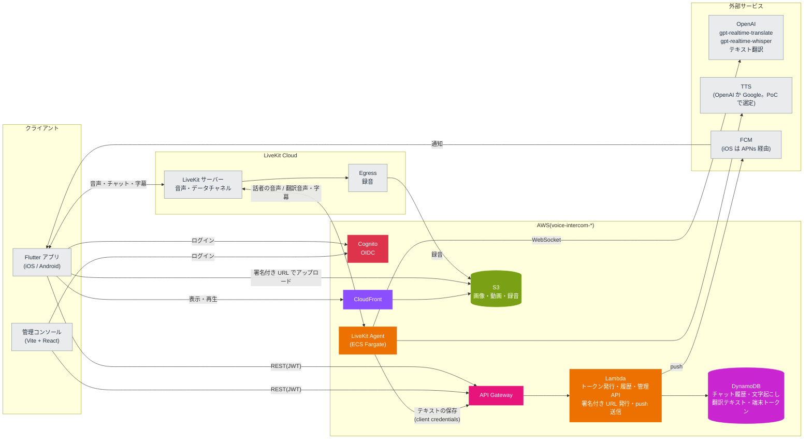

# voice-intercom

翻訳つきのボイスインカムアプリ。設計は [docs/設計メモ.md](docs/設計メモ.md) を参照。

## アーキテクチャ

音声・チャット・字幕は LiveKit で配信し、Agent が OpenAI で翻訳と文字起こしをする。履歴・メディア・トークン発行は AWS サーバーレスで持つ。



## 構成

| パス | 内容 | 開発する場所 |
| --- | --- | --- |
| `apps/mobile` | Flutter アプリ(iOS / Android) | ホスト |
| `apps/admin` | 管理コンソール(Vite + React) | devContainer |
| `services/agent` | LiveKit Agent(Python) | devContainer |
| `services/api` | API Gateway + Lambda(Python) | devContainer |
| `proto/` | データチャネルで流すメッセージの定義(Protobuf) | devContainer |
| `packages/schema/{python,ts,dart}` | `proto/` から生成した型。生成物もコミットする | 生成は devContainer |
| `packages/api-client/{ts,dart}` | REST API のクライアント。`services/api` の Pydantic のモデルから出した `openapi.json` をもとに生成する。生成物もコミットする | 生成は devContainer |
| `infra/` | Terraform(`envs/dev`、`envs/prod`。同じ AWS アカウントで名前を分ける) | devContainer |

## セットアップ

### ホスト(Apple Silicon の Mac)

1. Docker Desktop と [mise](https://mise.jdx.dev) を入れる(`brew install mise`)。
2. `cp .env.example .env` を実行し、`DEV_HOST` と `OIDC_ISSUER` をホストの LAN の IP に書き換える。
3. `mise install` を実行する(ローカルの LiveKit サーバー用)。Flutter を使うときは `apps/mobile` でも `mise install` を実行する。
4. Flutter の iOS ビルドには Xcode が必要。初回は `sudo xcodebuild -license` で同意しておく。

### devContainer

VS Code で「Reopen in Container」を選ぶ。初回に `.devcontainer/post-create.sh` が、ツールと依存関係(`uv sync`、`pnpm install`)を入れる。

## よく使うコマンド

| コマンド | 内容 | 実行する場所 |
| --- | --- | --- |
| `mise run gen` | proto から型を、REST API から OpenAPI とクライアントを生成する(`gen:proto`、`gen:api`)。Dart のクライアントの生成に使う Java は、初回にこのタスクが入れる | devContainer |
| `mise run lint` | buf lint、ruff、pyright、tsc | devContainer |
| `mise run fmt` | 整形 | devContainer |
| `mise run test` | pytest | devContainer |
| `mise run livekit` | ローカルの LiveKit サーバーを起動する(`--dev`、LAN に公開) | ホスト |
| `mise run build:api` | Lambda に載せるディレクトリ(`.build/api`)を作る | devContainer |
| `mise run plan:dev` | `build:api` の後に、dev 環境の `terraform plan` を実行する | devContainer |

## AWS(Terraform)

`infra/modules` に Cognito、DynamoDB、S3 + CloudFront(`media`)、API Gateway + Lambda(`api`)のモジュールがあり、`infra/envs/<env>` から呼ぶ。

1. `.env` に `AWS_PROFILE` と `TF_STATE_BUCKET` を書き、`aws sso login` する。
2. 初回だけ `terraform -chdir=infra/envs/dev init -backend-config="bucket=$TF_STATE_BUCKET"` を実行する。state 用のバケットがまだなければ、先に `scripts/bootstrap-tfstate.sh` で作る(dev と prod で共用し、キーで分ける)。
3. `mise run plan:dev` で差分を確かめてから、`terraform -chdir=infra/envs/dev apply` する。
4. 初回の apply の後に、LiveKit の API シークレットを SSM に入れる(Terraform には値を持たせない)。

   ```sh
   aws ssm put-parameter --overwrite --type SecureString \
     --name /voice-intercom-dev/livekit/api-secret --value <secret>
   ```

LiveKit の URL と API キーは `TF_VAR_livekit_client_url`、`TF_VAR_livekit_api_key` で渡す。

## ローカルの認証(模擬 OIDC サーバー)

本番は Cognito を標準の OIDC(認可コード + PKCE)で使う。ローカルでは、devContainer と一緒に起動する [mock-oauth2-server](https://github.com/navikt/mock-oauth2-server) に差し替える。

- issuer: `http://${DEV_HOST}:8090/default`(探索用の URL は `/.well-known/openid-configuration`)
- ログイン画面では任意のユーザー名と claims を入力できる。Cognito に寄せた claims の例:

  ```json
  { "cognito:groups": ["admin"], "token_use": "access", "client_id": "mobile" }
  ```

- client credentials(Agent から API を呼ぶとき)では、Cognito のアクセストークンと同じ形(`client_id`、`token_use`、`scope`)の claims を返す。設定は [.devcontainer/mock-oidc.json](.devcontainer/mock-oidc.json)。
- トークンの `iss` はリクエストの Host から決まる。そのため、クライアントは必ず `DEV_HOST` で接続する。コンテナ内から鍵(JWKS)を取るときは、`http://oidc:8090/default/jwks` を使う。
